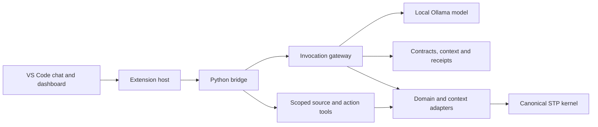

# Sutra 0.58.0 — Opt-in RTX prompt-prefix reuse

Sutra can reuse prompt prefixes across architecture discovery calls for the
same task on a verified RTX provider. To opt in, add the registered model
reference to `karma.remoteReviewPrefixReuseModels` in User Settings. The remote
runtime must use a single slot with `--cache-ram 0` and disk slot saves disabled.

Sutra ties reuse to the current task, permissions, model, template and server
process. It verifies the exact rendered prompt and charges the full prompt
count even when the server reuses part of it.

Sutra Auto can move a review to an eligible configured local model when a
remote capacity check blocks dispatch. Chat shows the measured resource
shortfall and when the saved review resumes.

Saved reviews can continue through workspace consent, catalog setup and
synthesis context recall with their approved scope and spent budgets.
The Ollama runtime distinguishes a preflight stop from interrupted inference.

Clear codebase review requests go directly to workspace consent. Approving
access continues the saved request in the same chat. Automatic reviews map
HTML and inline JavaScript with citations to the original file.

Sutra Auto answers standalone greetings without a model call. Eligible local
Ollama Low-tier chat calls keep the model warm for up to 60 seconds and can
reuse its context when fresh memory admission allows it.

Code-grounded answers address explicit cases individually using source defaults
and named methods. Python mapping keeps exact source evidence when an f-string
AST span is invalid. Named unittest requests use scoped test consent and an
isolated source snapshot. Automatic claim review can choose another eligible
reviewer when the preferred model cannot be admitted. An exhausted synthesis
call can use a remaining attempt for a compact report.

Architecture reviews start with the baseline context. The User Settings option
`karma.expandedReviewContextModels` allows eligible writers to use up to 64K when
the evidence needs more room and the current memory and task allocation allow it.
See [context profile requirements](docs/remote-gpu-provider.md#context-and-diagnostics).

Remote reviews can recover a timed-out identity inspection. Claim reviews for
remote models without reasoning controls use smaller pages. Compatible saved
read-only reviews retain verified checkpoints and consumed allocations.

Child reviews retain the output allowance earned from the selected model window
and remaining task allocation. Supported remote runtimes measure the actual
rendered prompt with their count-only API, independently of conservative spending
reservations. Unavailable remote measurements pause with their original cause
and an audit receipt. Recovery retains context, permissions and consumed budgets.

Remote NVIDIA inference is available through a trusted SSH profile. The remote
provider keeps model calls inside the existing invocation gateway and checks
fresh GPU memory, remote host RAM, model identity, context allocation and runtime
liveness. Local file operations still use local resource and permission checks.
Model switches retain task context, constraints, permissions and consumed budgets.

The provider is opt-in through Configure Models. Existing tier choices stay saved.
The separate Remote GPU section in Sutra Monitor distinguishes fresh measurements
from historical allocation decisions. Credentials and host profiles remain outside
the VSIX. See docs/remote-gpu-provider.md for setup and scope.

Authorized task stages now continue in the durable runner without requiring a
chat Continue after every checkpoint. Reloading VS Code detaches the display;
reconnect in the original chat to collect current progress or the final report.
Chat Stop and Stop runner request prevent further stages. Completed work,
source receipts, task context, permissions and consumed spending stay saved.

The existing backend state machine declares whether to continue, wait, request
authorization/evidence, or stop. A Karma continuation adapter gates automatic
transitions through the unchanged kernel and binds their permits to the existing
audit hash chain, task contract, checkpoint and runner identity. The runner
rechecks the captured workspace grant
before each operation. Only fresh, bound resource-readiness observations can
resume an eligible wait. Permission changes, unresolved effects, policy/source
recovery and allocation outside approved workspace limits require explicit action.
The runner cannot grant itself permissions or reset an allocation.

A queued or waiting checkpoint can recover after a runner restart under the same
runtime. A call interrupted in flight remains unresolved and is never replayed.
Model and reasoning settings stay fixed for an accepted run; explicitly stop or
pause it before resuming with another configured model. The same task identity,
checkpoints, constraints and prior charges carry across that change.

An independent bounded telemetry stream survives UI reloads. Inline workflow
progress stays separate from model reasoning, and the final usage footer includes
all recorded model calls. New child source pages also recover unseen imports and
global definitions above previously supplied function bodies. Complete source
delivery can bridge unresolved questions to the parent without claiming semantic
completion. The canonical STP kernel and model-tier settings are unchanged.

# Sutra 0.54.2 — Structured project reviews and chat recovery

Project review requests now receive source-linked report sections and a control-flow
view even when phrased as thoughts, strengths, weaknesses or tools logic. A bound
presentation profile keeps historical receipts unchanged. Auto can select stronger
synthesis after fresh source; fixed tiers and resource admission remain authoritative.
Concurrent chat requests receive status guidance without starting duplicate work,
and UI diagnostic or stream failures cannot strand the local busy state.

Child reviews now retain requested in-scope symbol names and page their complete
bounded declaration bodies before falling back to smaller source pages. Recovery
measures a real source-bearing packet and uses governed allocation within workspace
limits; a financial shortfall no longer recommends an unrelated larger model.
Saved checkpoints, permissions, receipts and consumed spending remain intact.

Accepted requests now run in a private, persistent coordinator outside the VS Code
UI. Reloading or stopping the chat display detaches it; send continue in the same
chat to reconnect without resubmitting work. Use Stop runner request in Sutra
Monitor or the status-bar controls for explicit cancellation. Each worker step
still uses the existing gateway, permissions and budgets. NPU retrieval remains
experimental and is not enabled by this update.

Shared-server retries no longer mistake a loaded Ollama model for a still-running
request. A free Sutra slot permits fresh admission for an explicit request, while
interrupted completion remains unverified and cannot authorize model unloading.
Context, permissions and past charges stay intact.

Conversation timeouts now keep a saved request that can resume on the selected
model without repeating workspace approval. The host distinguishes missing HTTP
response headers from an interrupted stream, preserves consumed spending, and
withholds incomplete output. A healthy shared model server may still queue work
behind another client; this recovery does not preempt those clients or increase
the existing timeout. Model tiers and shared-server settings are preserved.

Discovery notes and exact source spans now share a scoped contents directory
with report writers. Smaller contexts defer whole units behind retrievable
references; reloads and model changes preserve the journal, permissions and
consumed spending. Native workspace calls receive verified conversation context
and a paginated source index. Document extraction also receives prior user
criteria while its source quotations remain bound to the current section.
Independent reviewers receive source evidence rather than the writer's notes.

See [the consumer audit](docs/qa/MEMORY-CONSUMER-AUDIT-0.53.1.md) for scope,
remaining navigation limitations and the distinction between retained data,
delivered context and model understanding.

Architecture discovery observes actual source ranges and scoped tool requests.
Green adds no model-facing feedback. Yellow supplies one concise acquisition
update per accepted episode. Persistent repetition reaches a partial synthesis
checkpoint, preserving unresolved questions and all source receipts.

A planning holdback targets a writer and one claim-review page. Discovery also
has a finite allowance anchored in its first invocation, derived from the initial
writer and declared reviewer allowance. Reloads, model switches and later task grants
do not replenish it. Actual writing, additional review pages and repairs still
need fresh admission; this is not a guarantee of complete publication.

The existing Karma adapter and STP kernel govern the transitions. No semantic
truth, completion, permissions or additional allocation are inferred from text
novelty. Legacy execution profiles retain their original behavior.

Initial tuning warns after two consecutive non-advancing operations and attempts
partial synthesis after four. Two advancing operations clear a warning. These
are structural acquisition heuristics, not a contradiction detector. The initial
discovery allowance is twice the initial writer plus declared reviewer allowance;
the multiplier is an explicit initial policy, not a model capability guarantee.

Reviewer planning headroom is capped at twice a representative page probe and
the declared financial allowance. It is a measured heuristic, not a promise
that an unknown draft or future reviewer page fits. The stage ceiling keeps
its original declared-allowance basis; tuning headroom does not replenish or
silently shrink an established discovery allowance. Initial planning counts
and hashes are retained once in the audit trail, linked from the allowance.

An unchanged failed child JSON repair checkpoints its remaining attempt before
repeating the same request. A material input, model or generation-control change
can resume the same child. A financial increase alone cannot. Bounded format
diagnostics retain categories and parser positions, with generated text omitted.

An optional self-assessment placed inside an architecture report is extracted
as an observation before answer validation. Malformed diagnostics remain
observe-only. Their original placement and response hash are retained for
replay; other unknown report fields and duplicate placements still fail checks.
The report, citations, permissions and claim-publication gates remain in force.

# Sutra 0.52.0 — Bounded coherence observations

Sutra observes explicit questions, findings, assumptions and source references
already present in model-stage artifacts. Bounded graph checks flag stale or
missing evidence, circular support, unresolved commitments and possible conflicts
between scoped values. Hypothetical, subject and time contexts remain separate.
Model conclusions and completion claims remain unverified. These checks do not
parse arbitrary prose, add inference, grant permissions or close tasks.

A separate stream observer can flag sustained literal repetition in reasoning
while a call is still running. It retains bounded fingerprints and counters;
it does not judge correctness or automatically cancel or retry a generation.
Indicators appear in chat and Sutra Monitor. Original receipts, spending,
configured models and the canonical STP kernel remain unchanged.

# Sutra 0.51.9 — Source recall and thinking controls

Discovery recalls relevant whole source units from current verified receipts,
alongside its saved notes and directory. Required source and the fresh page
prefix remain protected during fitting. Paging a saved unit reuses its repository
receipt; each new model input still consumes its normal allocation.

Source-backed architecture planning can use supported Adaptive thinking. Explicit
On, Off and Model default choices are honored. The one-turn lightbulb boosts
planning and answering; delegated child reviews keep their configured base
reasoning. Settings, model tiers, permissions and consumed budgets are preserved.
The STP kernel is unchanged.

# Sutra 0.51.8 — Review lookup and validation

New architecture searches can target one authorized catalog file. Literal-query
limits, path admission and source accounting still apply. Older recorded search
requests retain their original behavior.

New discovery calls retain a small linked directory and their latest working
note. Relevant earlier notes can be recalled from accepted checkpoints after
eviction, reloads and model switches. Directory references remain scoped to the
current task and discovery journal; notes are unverified context.

Architecture checkpoint validation shares ancestry work only within one bounded
read pass. Source freshness, task identity and quarantine are checked before
results return; success is never cached across model calls or ledger changes.

The STP kernel, configured model tiers and consumed budgets remain unchanged.

# Sutra 0.51.7 — Review working memory

New discovery notes use the existing complete-note byte allowance. Brief notes
are encouraged without rejecting otherwise valid replies solely for a character
count. Released note profiles retain their original validation and receipts.

Discovery retains a bounded index of source ranges supplied to earlier accepted
calls when their bodies leave the working window. This records delivery, not
semantic review. Source reads and searches remain available.

New parent synthesis packets distinguish financial allocation from physical
context capacity before retiring earned source. Existing workspace limits govern
additional allocation. The STP kernel, permissions and model tiers are unchanged.

# Sutra 0.51.6 — Latest review recovery

An explicit Continue can offer recovery of the latest unpublished review before
an older automatically restored open task. Recovery compares original request
lineage, so restarting an older task does not make it a newer user ask.

The confirmed restart uses the existing task-stack transition to park older work
and retains the selected task's context, permissions and consumed spending. A
newer user request, another chat or a changed contract still blocks recovery.
Previous completed records remain unchanged. The STP kernel and model tiers are
unchanged.

# Sutra 0.51.5 — Active source and review recovery

Architecture discovery keeps its latest unread source page in the active working
set and pages optional catalog metadata first. New discovery calls receive a
bounded file index and short working notes; the full scoped catalog and source
receipts remain available to the host.

A physical context fit precedes financial allocation recovery, including providers
using conservative byte accounting. Reviewer identity failures are isolated so an
unavailable model cannot block an otherwise eligible available reviewer.

Explicit Continue can offer a confirmed policy restart of the latest unpublished
review in the same chat. It retains the original task and consumed spending;
previous terminal records remain unchanged. The STP kernel and model tiers are
unchanged.

# Sutra 0.51.4 — Targeted source discovery

Architecture discovery receives exact declaration line addresses from its fresh
source snapshot. It can jump to a supplied address or search for a missing link;
a truncated read does not require scanning the rest of the file.

New read pages follow the admitted context allowance, up to 16 KiB and 256 lines.
Their full receipts retain exact source bytes in small units that can be paged
when the working context changes. Accepted decisions bind page sizing, scope and
source charges. Historical reads retain their original recipe.

The STP kernel, model tiers, permissions and runtime retention settings are unchanged.

# Sutra 0.51.3 — Child allocation and review slices

Saved child reviews can recover execution time and other quantitative allocations
without replacing their checkpoints or resetting spending. The existing workspace
ceilings and ancestor gates still govern every increase.

New report and claim-review calls bind their transport deadline to the host's
admitted duration. Long attempts yield between bridge steps while retaining the
original retry ceiling. Historical calls and providers without shared deadline
support keep the existing timing profile.

Claim reviewers receive the exact static source statements delivered to the
writer, including statements outside its excerpts. Their evidence IDs bind text,
path and line. Static syntax does not prove runtime execution or semantic support.
The STP kernel, permissions and configured model tiers are unchanged.

# Sutra 0.51.2 — Source decisions and review recovery

Architecture discovery requests the next tool operation and a short working note.
It no longer asks the same decision to produce report findings and citations.
The existing gateway still checks scope, source receipts, cursors and budgets.
Discovery pages optional context before requesting capacity within the configured
workspace ceiling. Extra task capacity cannot override a physical context limit.

Timed-out Adaptive claim reviews retain their accepted draft, source plan and
remaining attempts. Interrupted or unknown usage remains charged. Historical
response profiles, the STP kernel and configured model tiers are preserved.

# Sutra 0.51.1 — Checkpointed review stages

Accepted architecture drafts are saved before claim review. The next bridge step
checks source claims without replaying generation. Interrupted stages retain
context, permissions, remaining attempts and consumed spending.

Before drafting, the parent can request source reads, literal searches and catalog
pages through the existing gateway. Each step returns a durable checkpoint, and
later steps use actual tool results to choose what to inspect next. Discovery
notes remain unverified; partial evidence is labelled when a boundary stops it.

Report sections use the allocated output capacity instead of fixed item counts.
References remain restricted to supplied evidence, and historical schemas keep
their original rules. System and token totals are placed before deep diagnostics.
The STP kernel and configured model tiers remain unchanged.

# Sutra 0.51.0 — Physical context and source discovery

Verified local token counts govern physical review context separately from the
existing task reservation and settlement units. Older receipts retain their
original profiles. Unsupported providers keep conservative context planning.

New source pages prefer requested symbols and central entry points, and continue
past complete accepted pages. Historical evidence recipes remain available.
Valid citations are bounded by supplied choices rather than a fixed four-item
limit. Adaptive claim evaluation can use supported reasoning when the answer
allocation has room. The preview offers request-flow and local-import views.
The STP kernel and configured model tiers remain unchanged.

# Sutra 0.50.8 — Evidence paging and clearer review sources

Child reviews use their accepted follow-up notes to retrieve missing evidence
within the assigned source scope. New review packets retain complete source lines
and avoid fragments that cannot explain an operation. Historical packets keep
their original evidence recipe for receipt validation.

Synthesis retains earlier findings while reducing repeated summaries and quoted
citation overhead; complete evidence remains in the host record. Chat groups
source links instead of repeating the full evidence-ID table. Context, permissions,
consumed budgets, configured model tiers and the STP kernel are unchanged.

# Sutra 0.50.7 — Findings from children, reports from synthesis

Child reviewers return their supported findings, citations and remaining checks.
They no longer need to duplicate the final architecture report in every source
partition. The parent synthesis retains its report format and evidence review.
Context, permissions, spent budgets and the STP kernel remain unchanged.

# Sutra 0.50.6 — Host-owned response admission and child repair recovery

Self-assessments are optional diagnostics. Child reviewers focus on their assigned
source work instead of assessing the whole parent task. Prompt examples no longer
supply unrelated project facts or filenames.

For Strata runtimes that advertise prompt-and-validate output, Sutra receives the
reply and measured usage before applying its own JSON/schema and evidence checks.
Settled child repair pauses retain checkpoints, remaining attempts and all spending;
allocation recovery extends the same branch without resetting sibling allowances.
The STP kernel and your configured model tiers are unchanged.

# Sutra 0.50.5 — Retained worklists and active-request sleep protection

Pending bridge requests hold a macOS idle-system-sleep assertion and release it
when work settles or stops. Display sleep and explicit system sleep remain
available. Deadlines and the STP kernel are unchanged.

Informational remaining-work lists no longer reject useful child checkpoints
for containing more than four entries. Individual text bounds, whole-response
allocations, source/citation checks and permission checks still apply; all
accepted follow-up items remain in the receipt and conversation pages.

# Sutra 0.50.4 — Reliable monitoring and bounded recovery

Monitor keeps live system readings and usage visible when task diagnostics fail.
Context admission records its memory plan before dispatch and distinguishes
a base-packet shortage from pinned conversation facts. A rejected child review
stops with its validation details and can use a bounded replacement without
joining quarantined output or resetting spending. The STP kernel is unchanged.

# Sutra 0.50.3 — Native workspace consent and review recovery

Sutra Auto asks for workspace reading in the native chat confirmation. Approve
once to continue the same saved request automatically; the read grant is
remembered for this workspace. Edits and tests retain separate confirmation.
No copied key or manual continuation is needed after native approval.

Whole-workspace reviews use the requested workspace scope instead of invented
router filenames. Failed catalogs report the original cause and retain saved
context and spending. A saved review with an incorrect router-generated scope
can correct that scope through an explicitly confirmed restart, preserving
its task history and consumed allocation. The STP kernel is unchanged.

# Sutra 0.50.2 — Controls in the bottom bar

Click **Sutra** in the bottom status bar to enable or disable chat, open Sutra Auto,
manage workspace access, choose models or reasoning, and open Monitor.
**Enable Sutra** keeps the current chat. **Enable and open Sutra chat** explicitly
opens a new Local chat with Sutra Auto, without sending a prompt or granting file
access. Busy requests keep Monitor available while settings changes wait.
Saved work, permissions, consumed budgets and the STP kernel are preserved.

# Sutra 0.50.1 — Concurrent receipt verification

Local ledgers use SQLite WAL snapshots so receipt verification can run alongside
committed work. FULL durability is retained. Protocol audit lookups target the
current session and run; an already verified connection rehashes only its own
new audit tail. Unanchored calls and explicit deep audits remain fully verified.
Host callers can retain their ledger and explicitly selected seal/audit profile
through the gateway; see [verification and trust](docs/receipt-verification.md).
The STP kernel, saved model tiers, context, permissions and spending
are unchanged. See the source validation record for measured costs and limits.

# Sutra 0.50.0 — Accounting recovery and idle checkpoints

Accounting seals retain explicit pending reservations and scope state, so work
can settle after its batch closes without losing context, permissions or spent
budget. Persistent request workers seal quiet accounting tails. Separate host
timings distinguish kernel evaluation, budget gates, seals and recovery.

Strict verification remains the default. The faster recovery API requires a
trusted head supplied outside the ledger; the package does not configure a NAS
or create an independent trust authority. See [accounting behavior and trust
boundaries](docs/accounting-batches.md) and the source validation records.
The canonical STP kernel and saved model tier choices are preserved.

# Sutra 0.49.1 — Native workflow stabilization

This maintenance release addresses the native-worker QA findings, including explicit
engine fingerprint approval, recoverable workspace permissions and chat navigation,
and clearer loading and admission states. Release checks now require every runtime
file in the VSIX. Diagrams follow the editor theme. The canonical STP kernel is
unchanged. See [the resolution register](docs/qa/RESOLUTION-0.49.1.md) for the
validation status and remaining limits.

Sutra can now load a compatible inference engine directly, without Strata
Control, a Strata HTTP server or Ollama on this execution path. A persistent
Sutra worker owns the engine child, tokenizer, chat template, generation stream
and cancellation. The existing invocation gateway still governs model calls,
source evidence, permissions and consumed task budgets. The canonical STP
kernel is unchanged.

Open **Sutra → Settings → Models → Sutra engine worker**, or run **Sutra: Manage
Owned Engine Worker**. Choose **Set up worker** to install the pinned tokenizer and
template dependencies in Sutra's own Python environment. Registered models use
`sutra:engine/<profile>` references and can be assigned to Low, Mid and High.
Loading a model changes the worker's active profile. **Save choices** is the
explicit step that changes tier assignments.

The VSIX contains the worker and codec code. The user-owned Python environment,
model registry, native engine binary, adjacent Metal/shader assets and model
files live outside the VSIX. They must be provisioned locally; setup does not
download model weights. Existing compatible assets on this Mac have been staged
under Sutra's Engine directory, with no runtime imports from Strata Control.

The current native architecture is the existing Flash-Next Metal model on this
Apple Silicon Mac. The 16K/24K/32K profiles use the same weights and validate
context allocation and switching, not different model capabilities. Other
architectures need a compatible engine adapter.

See [worker setup and boundaries](docs/owned-engine-worker.md) for registration,
recovery and validation details. Optional older provider integrations remain
available; selecting a Sutra worker model does not silently replace saved tiers.

## Sutra 0.48.0 — Native profiles for every tier

Low, Mid and High can each select a named native Strata profile. Stopped profiles
remain selectable and are loaded on demand at the invocation boundary. Native
activation and inference share an OS lease across Sutra windows. The same host
resource, role, permission, evidence and budget checks apply to all tiers.
The canonical STP kernel is unchanged.

In **Settings → Models**, choose native profiles for each tier and save. **Use
active native profile for all tiers** changes the draft selections first. When
all tiers use native profiles, model discovery, review selection, coding and
runtime monitoring do not require Ollama. Ollama remains an optional backend.
Loading a native profile manually changes the active runtime without rewriting
any tier assignment. The legacy `strata:high` selection remains compatible.

Different profiles of the same model share weights. Changing context or reasoning
does not make them different model capabilities. This Mac currently has only the
large Flash-Next native weight set; its installed 4B Ollama model is not supported
by that native Metal engine. No additional weights are downloaded automatically.

This release still uses Strata's native control/serving backend. It does not yet
embed the inference engine or remove Strata Control. Tier selection is separate
from backend execution, so a Sutra-owned direct engine worker can be added below
this boundary. Runtime management currently supports a local macOS host.

## Sutra 0.47.0 — Native model management

Open **Sutra → Settings → Models → Strata High runtime**, or run
**Sutra: Manage Native Models**. Discover installed native profiles, load or
switch the selected profile, and unload an idle instance. Sutra verifies
Strata's native generation readiness and server identity before saving High.
Low and Mid retain their Ollama choices. Automatic startup is optional.

**Add installed model…** registers a native run configuration as a serving
profile. **Locate Strata…** finds an installed native CLI without editing JSON.
**Set up / download a model…** previews Strata's recommended model and download size, then opens its
install-only setup in VS Code's Terminal panel after confirmation. Add the
resulting configuration and choose Load to activate it. Strata supplies model
acquisition, native execution and runtime ownership.
Model weights and the native engine are installed separately from the VSIX.
Native model-management controls are currently supported on a local Mac.

Cold memory estimates are bound to the exact profile, source configuration and
runtime environment. A new unmeasured profile uses fresh hardware and reserve
checks while Strata sizes its own runtime. Loading refreshes system pressure;
this is not a verified peak-memory estimate. A failed load retains the saved
selection and reports whether the previous native profile could be recovered.
Automatic startup uses the selected profile's saved admission mode.

These controls are trusted user actions. Models cannot choose native executable
paths, install components, or change permissions through this manager. Provider
changes leave durable task context, constraints and consumed budgets in place.
The canonical STP kernel is unchanged.

## Sutra 0.46.0 — Persistent host memory

Normal requests reuse a workspace-scoped Python worker. Active RAM holds decoded
pages and receipt data used by the current request. Recently used entries move
to warm RAM and can be promoted on reuse. The shared retention limit defaults
to 64 MiB. Set **Karma › Ram Memory MiB** (`karma.ramMemoryMiB`) in User Settings,
or set it to `0` to disable retention. Hardware and memory admission can clear
retained copies under pressure.

Durable writes, source freshness, receipt integrity, permissions and task
allocations keep their existing checks. Worker termination discards RAM copies
and the next request recovers saved work. Sutra Monitor shows retained bytes,
active and warm hits, reloads, evictions and JSON processing time.

The local 20-run host benchmark measured median round trips of 106.8 ms with
fresh processes, 26.5 ms with persistent processes and retention disabled, and
27.0 ms with active/warm retention. Process reuse supplied the measured gain.
The RAM layer showed no additional overall gain on the tested corpora.
Reproduce the measurements with `scripts/measure-ram-compartments.py`.

## Sutra 0.45.4 — Native Strata runtime management

Sutra uses Strata's native runtime management for background startup, status
and stopping. Strata owns its processes, readiness checks and recovery of
interrupted runtimes. Sutra checks the selected model, local profile and fresh
hardware before starting a cold provider. Startup is off by default.
In **User Settings**, set
`karma.strata.port` and `karma.strata.model`, choose `strata:high` for High,
and enable **Karma › Strata: Start On Startup**. Low and Mid are available
while Strata loads.

Create a named Strata serving profile with `strata profile create NAME
--from-config /absolute/path/config.json`. On this Mac, put a `startup.json`
record in `~/Library/Application Support/Sutra/Strata` with the selected
`port` and `model`, an absolute native CLI `executable`, the saved `profile`
name, its measured `cold_memory_bytes`, and any required `environment`
overrides for the installed Strata files. These are machine-local settings.
Sutra checks Strata's launch plan against the selected local model and port.

Use **Sutra: Start Strata High** after resources recover, and
**Sutra: Stop Strata High** to drain an idle managed provider. The native
runtime can serve independently of VS Code. Stopping requires its current
owner and instance identities. Requests still pass through Sutra's existing
invocation gateway, resource checks and task budgets.

## Sutra 0.45.3 — Strata High startup

Added optional startup for a locally registered Strata service and a Command
Palette action for manual recovery.

## Sutra 0.45.2 — Model availability

Low and Mid remain available during a High provider outage. Auto reports
which available configured model it can use for work routed to High.
Fixed High reports how to recover Strata and retains the configured model.

## Sutra 0.45.1 — Strata review reliability

Strata selects IDs for source citations. Sutra resolves each ID to its exact
quotation before validating and recording the review. Adaptive requests carry
a reasoning and generation allowance within the existing transport deadline.
An eligible synthesis timeout can use an existing repair attempt with thinking
off. Architecture requests can name functions to prioritize their source in
the review packet.

## Sutra 0.45.0 — Opt-in Strata High

Ollama supplies the default model choices and the Low and Mid tiers. Strata
is an experimental option for High in native chat and read-only workspace
reviews. Sutra uses its existing invocation gateway, source and budget checks,
and local resource gate. The Strata server must already have its model loaded.

1. Start your Strata server on `127.0.0.1`. Open its `/v1/status` endpoint and
   note the server port and the exact `model` value.
2. In VS Code **User Settings**, set **Karma › Strata: Port** (`karma.strata.port`)
   and **Karma › Strata: Model** (`karma.strata.model`). Leave authentication
   tokens in the extension host's `SUTRA_STRATA_API_KEY` environment variable
   if your local server requires one.
3. Run **Sutra: Configure Local Models** and refresh the models. Select
   **strata:high** in High, then save. Pick **Sutra High** in chat for a fixed
   route, or **Sutra Auto** to use the configured tiers when the workflow routes
   to them. Use an Ollama tier for edits or tests.
4. To return High to Ollama, select an Ollama model and save. Set the Strata
   port to `0` to disable Strata discovery.

For launch-time configuration, `SUTRA_STRATA_PORT` and `SUTRA_STRATA_MODEL`
apply when the corresponding User Settings are unset.
`SUTRA_STRATA_CONTEXT` can cap Sutra's context allocation. Strata's buffered
structured replies still undergo Sutra's schema and role checks, and
incremental Strata memory use is uncalibrated.

## Sutra 0.44.1 — Recover child allocations

Read-only workspace reviews can save a child's findings and next step before
continuing its partition. On a timeout or output-limit pause, select a tier
and send `continue` in the same chat to finish the saved slice. If the packet
only fits with one attempt reserved, Sutra can run that attempt within the
existing child allocation. **Increase allocation** in Sutra Monitor can add a
measured shortfall to a paused child and its parent execution. Checkpoints,
read scope and recorded spending stay with the review.

# Stage long document reviews

Ask Sutra Auto to review a named workspace DOCX and approve its read. Sutra
splits extracted text above 24 KiB into sections, up to 96 KiB total, and
records source quotations from each section. Auto starts synthesis on Low and
checks its answer against those quotations. It can retry synthesis on a higher
configured tier after an unsupported conclusion, within the same approval and
task allocation. The evidence assessment is a model judgment. A fixed model
tier runs extraction and synthesis with the selected model.

# Sutra 0.42.1 — Isolate chat and document context

A native chat restores receipts that belong to its workspace and conversation.
Approving a new named DOCX starts a document-specific working set. Reviewing the
same approved snapshot can carry forward its earlier review turns.

# Sutra 0.42.0 — Resolve implicit document follow-ups

Ask a follow-up in the chat that reviewed a document. When one approved
snapshot is eligible, the classifier can request it using an identifier.
The host verifies the selection before providing the snapshot for the answer.
An unclear target can trigger a question. Named files use scoped approval.

# Sutra 0.41.3 — Resolve absolute DOCX paths in the workspace

Ask for an opinion on a named DOCX using an absolute or relative path in the
active workspace. Sutra resolves the path before requesting a scoped read.
Continue the saved request in its original chat to recover from an earlier
request for pasted text.

# Sutra 0.41.2 — Continue an approved document review

A follow-up about the same document in the original Sutra chat can reuse the
approved snapshot across reloads and model changes. Name a new file to request
a separate read. Résumé feedback uses documented figures or explicit placeholders.

# Sutra 0.41.1 — Review named workspace documents

Name a DOCX in Sutra Auto to review its text. Sutra looks for the file in the
active workspace folder and asks before reading it. When names match more than
one file, choose the intended path. The saved evidence request can resume in the
same chat after approval. **Document text:** remains available for pasted excerpts.

# Sutra 0.41.0 — Resume when evidence arrives

When a review needs a document or a source target, Sutra pauses the request.
In the same chat, paste the relevant résumé section below **Document text:**
or resolve a missing source scope with **Use this workspace** or
**Workspace files:** followed by one relative path per line. The saved request
continues across reloads and model changes with its existing context and spending.
Workspace access still follows the workspace's authorization settings.

# Sutra 0.40.1 — Route document reviews in chat

Sutra asks for the text when a résumé, CV, or cover letter is referenced but
its content is missing. Paste a section below a separate **Document text:**
heading in Sutra Auto to review it in chat.

# Sutra 0.40.0 — Open tasks in native chat

A new workspace request can park the focused task and start with its own goal
and scope. Use **Open tasks** in Sutra Monitor or **Sutra: Open Tasks** in the
Command Palette to focus, resume, or close a task from the last active Sutra
chat. Finishing or closing the focused task restores focus to the previous
open task. Send **continue** in the originating chat to resume it, using
whichever Sutra model tier you want to run next.

Each task retains its workflow checkpoint, Smriti memory references, permissions
and consumed allocation across reloads. Resuming revalidates the source and
permission binding. Saved edits and tests still require action confirmation.

# Sutra 0.39.0 — Adaptive thinking and fixed-tier settings

Adaptive requests the model’s lowest supported positive reasoning level for substantive conversation. Sutra looks for request cues such as debugging supplied code, numerical planning, comparing approaches or explaining trade-offs, and explicit requests to reason. Routine or unclassified chat starts at the lowest known level. This check runs in the host without another model call.

During a workspace review, Sutra uses fresh evidence and the stage’s allocation. Source-backed architecture planning can use the lowest supported positive effort. A report writer synthesizing multiple files can use thinking when the existing allocation has the full output reserve and a spare draft attempt; eligible claim checks also use supported thinking. Child reviews follow their configured base reasoning. If thinking exhausts the report writer’s output reserve, Sutra can use an existing attempt to retry at the lowest level.

Run **Sutra: Configure Reasoning**. The shared setting applies to **Sutra Auto**. Each fixed tier pins its configured model and can **Inherit** the shared choice or use **Adaptive**, **On**, **Off**, or **Model default**. The Chat title bar lightbulb boosts planning and answering for one turn; child tasks retain their configured reasoning. Open a call’s details to see which control Sutra actually requested.

# Sutra 0.38.5 — start in chat and recover reviews where they stop

Use **Sutra: Open Chat (Sutra Auto)** to start in VS Code's native Local Chat. Ask for a review and describe the scope you want. Sutra asks for workspace access when needed, then discovers and reads relevant files.

The advanced architecture review proceeds from inspection to report. If it needs evidence from another file, **Read another file and retry** uses the review's existing scope and remaining budget.

When a native request pauses, choose **Resume this request** in the original chat or **Resume** in Sutra Monitor. Sutra first attempts to target that original Local chat. Some VS Code hosts ignore the target session in generic open-chat commands; on those hosts Sutra offers to copy a single-use continuation instruction. Paste it into the original Local chat with Sutra Auto selected. Sutra does not open an unrelated chat or a sign-in flow as a fallback. To resume using a specific model tier, select it and send **continue** in the original chat.

Sutra Monitor shows why a review stopped and which recovery actions are available. The dashboard also improves keyboard navigation, form labels and control contrast.

# Sutra 0.38.4 — verify protocol events and explain review stops

Sutra checks protocol events against their hash-chained audit copies. New events include host timestamps. Architecture preflight stops appear in the review panel and Sutra Monitor.

The review panel shows catalog exclusions and the remaining repository operations. Catalog scans use one operation each. Sutra verifies the current budget and contract when it commits an operation and checks replay identity before returning a receipt. When source evidence is short and the repository budget is exhausted, the review reports a terminal stop.

Headless admission can refresh missing or expired telemetry with the bundled sampler on supported hosts.

# Sutra 0.38.3 — recover an architecture review step

The **Sutra: Review Codebase** workflow checks for enough current source evidence before requesting a report. It can reuse settled reads even if earlier model notes omitted them. If an architect call reaches its output limit, Sutra can spend one existing retry with thinking off, keeping the prior checkpoint and read receipts. A read continuation must match a cursor issued for that file.

# Sutra 0.38.2 — resume an interrupted claim review

If the architecture claim reviewer reaches its output limit with thinking enabled and a retry available, Sutra pauses with the draft, completed reviews, source evidence and consumed budget saved. Choose **Resume** in Sutra Monitor, then send **continue** in chat. Sutra requests thinking off for the unfinished page and checks that the saved source evidence is current.

# Sutra 0.38.1 — thinking for one chat request

Click the lightbulb in the VS Code Chat title bar, or run **Sutra: Think on Next Request** from the Command Palette. This requests thinking for one Sutra turn even with Adaptive selected. Click the lit bulb or run **Sutra: Cancel Thinking for Next Request** before sending to cancel. Later requests use your saved reasoning setting. Sutra shows thinking inline when the local model streams it.

# Sutra 0.38.0 — Git provenance and targeted architecture evidence

Architecture reviews record the open checkout's commit, branch and working tree status before reviewing source. Upstream status uses local tracking data and is labeled accordingly. A request for the latest upstream version asks you to confirm the open snapshot or open the intended checkout. Sutra checks the snapshot again before it publishes the report.

The review can request up to four precise source excerpts in one follow-up round. The host checks each requested path and line against the workspace scope and admitted plan, charges the active allocation, and verifies source against the read receipts before publication. Evidence selection uses the lowest advertised reasoning setting. The final review uses your configured setting.

# Sutra 0.37.0 — automatic allocation within workspace limits

Read-only native reviews can draw from a workspace reserve when the host measures a shortfall. The reserve uses cumulative ceilings per review. The defaults are 128 MiB of source, 2,000 repository operations, 80 model calls, 500,000 model budget units and 3,600 seconds. An approved draw increases the working allowance, preserves previous spending and creates a linked bounded execution. Sutra revalidates any source receipts it carries forward.

Use the User setting **Sutra: Workspace Allocation** to override these ceilings or disable automatic draws. The setting accepts `enabled`, `source_bytes`, `operations`, `calls`, `tokens`, `seconds` and a `byFolder` map keyed by the local workspace root. Each folder override accepts those same six policy fields. Workspace files cannot grant reserve authority. Explicit overrides outside the automatic ceiling still use **Sutra: Increase Task Allocation**.

# Sutra 0.36.0 — source budget recovery on saved reviews

Sutra checks the pinned task, constraints and conversation against the selected model's context before opening source for a review call. After a pause, it can reuse a settled source snapshot for the same saved execution after checking the current file bytes. Changed files need fresh analysis within the remaining allocation.

Work started under an older policy uses the explicit review restart. If the old review has already spent its source allocation and has no eligible snapshot, increase the task's allocation in Sutra Monitor before restarting. Previously consumed work remains recorded.

# Sutra 0.35.0 — persistent workspace permissions

Choose **Sutra: Workspace Access…** from the Command Palette or pick a profile the first time native chat needs project files. **Read only** enables scoped reads. **Workspace agent** also enables scoped edits and sandboxed tests with the existing action approval flow. Optional tools have their own approval policy.

Sutra restores the profile when you reload a trusted workspace or switch models. Use **Sutra: Revoke Workspace Access** to remove it. Paused requests retain their context, task constraints and consumed budget. Send **continue** to resume a saved request.

# Sutra 0.34.0 — bounded execution sessions and fresh source paging

Workspace requests now have a fixed execution allowance inside the cumulative task budget. Retries, reloads and model switches preserve that allowance, memory and permissions. A later execution uses only the task capacity that remains; an explicit increase creates a linked successor without erasing spending.

Before asking for more capacity, mapping and synthesis select smaller fresh source pages and disclose deferred files. The monitor shows execution spending and paging alongside cumulative task totals. The canonical STP kernel remains unchanged. See [execution sessions](docs/execution-sessions.md) and [validation](docs/validation-0.34.0.md).

# Sutra 0.33.0 — registered tools with governed installation

Sutra can now request Ruff lint checks and Pyright type checks from native chat. Ask “Run Ruff on code.py” or “Check code.py with Pyright.” The host offers installation if needed, then a separate source-check approval. **Sutra: Manage Tools** opens the catalog. Sutra Monitor provides **Manage tools** and **Tool permissions** buttons.

Use **Sutra: Configure Tool Policy** to choose Ask each time, Preapprove selected operations, or Disable optional tools. A preapproval requires one explicit confirmation of the workspace, operation list and registry identity; changing that policy or registry requires confirmation again. A repository settings file cannot grant itself authority. Workspace permissions and optional tool approvals are separate.

The first registry pins Ruff 0.17.5 and Pyright 1.1.414 to official package URLs and integrity hashes. Installation uses Sutra storage, without package-manager scripts or changes to project dependencies. Checks use fresh, approved Python snapshots in the macOS sandbox, with no network, source writes, fixes or project configuration. Other platforms have package mappings, but execution currently fails closed until a sandbox adapter is implemented and tested.

Tool operations reserve task/ancestor capacity and retain consumed charges through interruption and model changes. Receipts and paged diagnostic evidence use the existing Smriti store. Lost replies recover from receipts without replay; a newly approved reinstall quarantines an unverified prior copy. The canonical STP kernel is byte-for-byte unchanged. See [tool permissions and operation limits](docs/capabilities.md) and [validation](docs/validation-0.33.0.md).

# Sutra 0.32.0 — paged architecture claim reviews

Architecture reports now receive a separate claim review in context-sized pages. Each page carries complete claims and host-generated evidence IDs bound to exact source text, paths and line locations. The reviewer selects IDs instead of copying quotes. All relevant claim/evidence pairs must be reviewed before publication; a contradiction on any page withholds that claim. Source IDs prove provenance, not correctness.

Accepted pages and the original draft survive interruption. Retrying the same request can continue unfinished review pages with another configured model, after fresh source, contract and reviewer-identity checks. Completed pages are not replayed. Each page has at most two total attempts across restarts; every dispatch still needs context, resource and remaining task allocation. Model changes never refund consumed budgets or grant permissions. Source-linked IDs appear in the report; detailed page judgments remain available in review details.

The canonical STP kernel is unchanged. This is a bounded review of the writer's supplied excerpts, not an exhaustive semantic review of every mapped file. Claims requiring evidence spread across pages can remain unsupported. A smaller model must fit each saved page; saved plans are not silently rewritten to drop context.

# Sutra 0.31.0 — explicit task allocation recovery

When a saved review pauses because its task/context allocation is too small, open Sutra Monitor and choose Increase allocation… (or run Sutra: Increase Task Allocation). Review the added capacity and new totals in the confirmation dialog. Approval preserves the original task, constraints, context and all consumed spending; send continue in the same chat afterward. If an extension update requires Restart review, accept that separate recovery choice to read source afresh.

Allocation approval does not start inference, grant file permissions, enable reasoning, or override hardware/model capacity. The model cannot raise its own budget. Monitor shows spent/total amounts and the amendment version.

See [allocation recovery and protocol boundaries](docs/allocation-recovery.md).

The local model receives a versioned task-facing packet: the request, relevant requirements, fresh evidence, available action choices and Smriti memory. Governance identities, resource decisions, budget records and constraint echoes remain in the host. The gateway binds the exact projected packet to its dispatch permit and attaches host metadata only after checking the raw model response. Host-bound metadata is explicitly labelled; it is not a model acknowledgement or proof of compliance.

Every new call reserves its conservative model-input charge and output allowance before dispatch. Completed backend counts settle the task and ancestor charge, including failed or withheld generations. Only unused reservation is released; missing measurements, interruptions and historical calls retain their original reservation. See [model boundary and accounting](docs/model-boundary.md) and [validation](docs/validation-0.30.0.md). The STP kernel remains byte-for-byte unchanged.

# Sutra 0.29.1 — bounded review output and adaptive reasoning

Adaptive now starts workspace generation at the lowest known reasoning control. Architecture writers, child reviewers and report checkers record that choice and recheck capabilities before dispatch. Report prompts scale detail to supplied evidence, with explicit character limits. A truncated answer stays quarantined; at most one shorter regeneration can use an already allocated review attempt. Every attempt remains charged. Explicit On and Model default preferences remain unchanged. See [validation](docs/validation-0.29.1.md).

Memory admission now credits only reusable weights for an exactly matched loaded model, while preserving working-memory margins and the system reserve. Auto workspace reviews and coding workflows can try a smaller configured model after a capacity refusal before inference. Fresh paging and all protocol checks run again; context, permissions, completed children and consumed budgets remain intact. The STP kernel is unchanged. See [runtime allocation and fallback](docs/runtime-allocation.md).

## Unified memory faults and retention

A shared lifecycle layer now classifies page faults, preserves dependency-safe eviction, restores exact conversation pages from verified receipts and records bounded working-set diagnostics. Sutra Monitor shows context memory alongside runtime resources. Paused workflows retain permissions, completed children and consumed budgets across reloads and model switches. The STP kernel is unchanged. See [memory lifecycle](docs/memory-lifecycle.md).

# Sutra 0.27.0 — observe-only task commitments

Workspace tasks can now record what the routing model understands and what it plans to deliver, then collect the worker’s assessment against those criteria. The original prompt and host constraints remain authoritative. Native chat and Sutra Monitor display these as unverified observations. See [task commitments](docs/task-commitments.md) for scope, evidence and limitations.

# Sutra

The 0.28.1 display fixes are included: native thinking blocks require actual reasoning text from the model; metadata-only calls show **call details** instead. Source mapping, workflow progress and resource pauses are labelled as host status. A resource stop is not a model answer.

Sutra 0.26.1 clarifies workspace routing for architecture and onboarding requests, replaces the raw schema in the prompt with a compact writing guide, and shows the effective reasoning setting in **Sutra Monitor**. The full decoder and host schema remain enforced. Protocol admission is explicitly distinct from task completion or answer correctness.

Sutra 0.26.0 gives conversation models a task-focused prompt while the host
retains the full contract and attaches context identity to admitted responses.
Missing-context requests must name a Smriti page or ask a specific question.
A narrow compatibility adapter fixes escaped-text truncation in the tested
Ollama 0.40.16 MLX structured decoder; strict host validation remains in place.
Adaptive reasoning keeps routine chat fast and selects supported effort for
explicit reasoning, numeric planning, code analysis and fenced structured results before bounded escalation.
Existing settings, permissions, consumed budgets and the STP kernel are preserved.
See [prompt and reasoning policy](docs/adaptive-reasoning.md) for scope and limits.

Sutra 0.21.3 supplies architecture reviewers with a fresh inventory across mapped source partitions, budgeted implementation excerpts, and available child answers. Empty optional memory pages and the absence of harness-created artifacts no longer imply absent repository source. Review context follows installed model capacity within remaining task/ancestor allocations, with room for bounded repairs. The response labels exactly how many mapped files, excerpt files and child reports were delivered. This remains a bounded architecture review, not an exhaustive semantic audit of every file.

Sutra retains separate diagnostics for every routing, child and workspace-review call. Click a **call details** link in chat or **Open call details** in Sutra Monitor. The read-only pane updates during generation and stays available after a reload within the retention window. Native thinking requires a returned reasoning stream; VS Code controls how its inline blocks are grouped.

Sutra 0.21.1 fixes same-chat workspace handoff: tool-free conversation-stage restrictions no longer describe the whole harness. Known false file-access refusals go through bounded repair. Verified conversation history from released 0.20.x and 0.21.0 policies remains available after reload; old action authority is not restored. Workspace arming, scope and remaining budgets still apply.

Sutra 0.21.0 streams local-model reasoning separately from accepted answers. Open **Sutra Monitor → Calls & reasoning** for expandable parent/child details, their model, status and final token usage. Compatible VS Code hosts also show native thinking parts inline; hosts without that capability use the Monitor. Choose **Sutra → Settings → Model reasoning**, then save runtime settings, to request reasoning on (lowest supported level) or model defaults. Adaptive is the default for new configurations; existing choices are preserved and some models always reason.

Reasoning is unverified diagnostic text, never a task-memory page, permission, test proof or accepted answer. Reasoning and answers share the existing output allocation. Ollama supplies total output counts, not separate reasoning-token counts. Diagnostic history is saved locally as plain text in the extension’s per-workspace `reasoning.json`, bounded to 12 calls, 7 days, 1 MiB and 16,000 characters per call. It may include source references emitted by the model. This is separate from Smriti/task memory and immutable protocol evidence. A window closing mid-call is shown as interrupted, never as completed. Retention errors appear in the Monitor without aborting governed work. Older vanished reasoning cannot be recovered; previous versions omitted response bodies from disk traces.

Local model orchestration for VS Code. Switch models while keeping the task,
constraints and accepted context in a local ledger.

Sutra was previously called **Karma**. The **0.16.0** release changed the public name
while retaining the extension identity and stored settings. This is an
experimental local tool, not a guarantee that model answers are correct.

## Use it

1. Install the VSIX in VS Code using **Extensions: Install from VSIX**, then reload.
2. Start Ollama and install the local models you want to use. Python 3.9+ is
   required for the harness.
3. Run **Sutra: Open Chat (Sutra Auto)**. This saves the compatible Local
   chat and model selection for new chats. Existing chats retain their selection.
4. Chat normally. The first request that needs project files offers **Read only** or **Workspace agent** permissions and continues in the same chat after approval. Sutra remembers the choice for this trusted workspace across reloads, updates and model changes. Workspace agent access lets Sutra request file scopes for edits and local tests, then confirm each exact action. Manage or revoke access from **Sutra: Workspace Access…** or the dashboard.

Sutra discovers installed models and fills empty tiers. Use **Sutra: Configure
Local Models** to change those choices. **Sutra Low**, **Sutra Mid** and
**Sutra High** are explicit overrides in the native model picker. Open **Sutra
Monitor** for recovery and diagnostics, or the dashboard's **Tools** for
advanced review and calibration controls.

### Governed orchestration

Native chat uses a persisted host state machine for classification, user grants,
source mapping, child reviews, joins, synthesis and action settlement. The UI
sends events; model output cannot create or widen permissions. The adapter proposes
source partitions from measured file/call counts and remaining allocations. The
unchanged STP kernel admits or stops the proposed work.

Children run sequentially in the same request. Each has a reserved share of its
parent budget, an immutable context binding and a narrower read scope. Their fresh
calls receive the full contract and a budgeted Smriti working set. Failed calls
consume allocation. Model switches and reloads cannot reset that use. Source
versions and child receipts are checked again before synthesis.

After interruption, choose **Resume this request** in the original chat. To
choose a different model explicitly, select a Sutra tier and send **continue**
there. Replacing the saved request requires confirmation and releases unused child
reservations. The saved task retains its constraints, consumed budget and
evidence. Saved workspace permissions are checked again when work resumes.
The monitor shows request/child states, model assignments and allocation use.

This version branches read-only reviews. Editing and tests remain governed parent
actions with exact-action confirmation. Local children are sequential, not parallel
inference. Source partitions do not prove semantic independence; reviewers explain
bounded excerpts and static relationships, not every function's correctness.
The host's role/source/permission validators remain necessary alongside the kernel.

### Combined monitor

Click **Sutra Monitor** in the status bar, or run **Sutra: Open Monitor**.
The dashboard opens in the bottom panel beside Terminal and Output, so it can
stay visible alongside chat and code. `@sutra /usage` opens the same view.

CPU/GPU temperatures, CPU usage, memory, kernel decisions and checkpoint status
appear above token history. Expired hardware readings clear automatically. Each
kernel check is shown separately; a resource ALLOW does not grant task permission.
Temperature readings remain advisory. Expand diagnostics for normalized signals.

Input/output cards, recent-call charts and stage breakdowns update from local
receipts. Filter by model, stage, outcome or time; expand individual calls for
budget allocations. Counts appear when each call finishes. Missing counts are
marked unknown, and filters apply to the latest 250 workspace calls. Viewing
usage never invokes a model. The original editor dashboard also links here.
The previous **Sutra: Open Token Usage** command remains an alias.

VS Code compacts its assembled conversation when its context budget is tight.
Sutra preserves an authenticated checkpoint for recognized compaction requests;
it does not send those requests to Ollama. See [context and compaction](docs/context-and-compaction.md)
for model-specific allocations, verbatim recent turns, pinned quotations and older-page retrieval. The working note is still unverified and retrieval is not a guarantee of semantic recall.

The status bar shows workspace access. Check for a Sutra model beneath the
prompt and invocation details in its response to confirm routing.

## What is included

- Fresh, scoped source discovery and paging; deterministic Python/TypeScript maps.
- Local model routing, API-map review, bounded repair and checkpoint quarantine.
- Governed Python edits and test process execution, with immutable receipts.
- Conversation checkpoints that survive supported native chat compaction and
  model switches without replaying the full transcript to each model.
- Offline diagrams and input/output token accounting by invocation and stage.
- Resource and budget monitoring with separate Karma/domain and Smriti/context
  adapters using one unchanged STP kernel.

## Architecture



The kernel decides **ALLOW**, **BRIDGE**, **FIN** or **COMPOUND_FIN** from normalized
measurements. Adapters validate inputs and apply domain rules; the kernel does
not assess the truth of a model's prose. Its pinned SHA-256 is:

```
9dfef2479b9af1b8f82282597f13b1205c31b19ba4ff52f60e305f1757ed4eac
```

## Development and tracking

See [development instructions](docs/development.md), [release notes](CHANGELOG.md)
and [known limitations](docs/known-limitations.md). The imported Karma 0.15.1
baseline remains a separate commit; `v0.16.0` records the Sutra rebrand.

Build an offline VSIX with `python3 -B package.py --output dist`.
Generated packages, local databases, logs and conversation traces are ignored by
Git. Commit source changes deliberately; Git does not automatically record edits.

Compatibility identifiers such as `deepak-local.karma-local-harness`, `karma.*`
settings/commands, model IDs and signed receipt URLs are intentionally retained.
They preserve existing settings, storage and conversation pointers. Do not rename
them without an explicit migration.

This repository does not grant an open-source license for original project code.
Bundled third-party components retain their own licenses; see
[third-party notices](THIRD_PARTY_NOTICES.md).

Sutra Auto begins new requests with the configured low tier. Requested conversation pages are loaded before model escalation; stronger models keep the same original request, pinned context, permissions and spent allocation. Explicit tier selections remain fixed. Workspace worker selection follows fresh scoped source retrieval. New messages reach conversation routing even while a review is saved. Greetings stay conversational. A new workspace request asks before replacing saved work. Mapping pauses show their causes and coverage in chat, with file diagnostics in Sutra Monitor. Resume submits the saved request in the originating chat and keeps its draft. Stop retains context, receipts and consumed allocation. A budget-limited resume can pause again.
