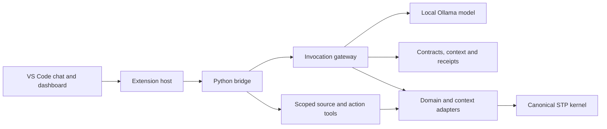

# Sutra

Local model orchestration for VS Code. Switch models while keeping the task,
constraints and accepted context in a local ledger.

Sutra was previously called **Karma**. Version **0.16.0** changes the public name
while retaining the extension identity and stored settings. This is an
experimental local tool, not a guarantee that model answers are correct.

## Use it

1. Install the VSIX in VS Code using **Extensions: Install from VSIX**, then reload.
2. Start Ollama and install the local models you want to use. Python 3.9+ is
   required for the harness.
3. Run **Sutra: Configure Local Models**. Choose the low, mid and high tiers from
   installed models.
4. Run **Sutra: Open Governed Chat (Sutra Auto)**. This saves the compatible Local
   chat and model selection for new chats. Existing chats retain their selection.
5. Chat normally. For workspace access, use **Sutra: Arm Task and Open Chat** to
   select a task and scope. Proposed edits and tests require confirmation.

The native model picker offers **Sutra Auto**, **Sutra Low**, **Sutra Mid** and
**Sutra High**. The review participant is **@sutra**. The dashboard has Overview,
Chat, Usage, Settings and Tools views.

### Token dashboard

Click **Sutra Usage** in the status bar, or run **Sutra: Open Token Usage**.
The dashboard opens in the bottom panel beside Terminal and Output, so it can
stay visible alongside chat and code. `@sutra /usage` opens the same view.

Input/output cards, recent-call charts and stage breakdowns update from local
receipts. Filter by model, stage, outcome or time; expand individual calls for
budget allocations. Counts appear when each call finishes. Missing counts are
marked unknown, and filters apply to the latest 250 workspace calls. Viewing
usage never invokes a model. The original editor dashboard also links here.

A ready or armed badge does not prove that every VS Code prompt uses Sutra.
Check the selected model and the response's invocation details. Direct Ollama
models and other providers can bypass this harness.

## What is included

- Fresh, scoped source discovery and paging; deterministic Python/TypeScript maps.
- Local model routing, API-map review, bounded repair and checkpoint quarantine.
- Governed Python edits and test process execution, with immutable receipts.
- Conversation checkpoints that survive supported native chat compaction and
  model switches without replaying the full transcript to each model.
- Offline diagrams and input/output token accounting by invocation and stage.
- Resource and budget monitoring with separate Karma/domain and Smriti/context
  adapters using one unchanged STP kernel.

## Architecture



The kernel decides **ALLOW**, **BRIDGE**, **FIN** or **COMPOUND_FIN** from normalized
measurements. Adapters validate inputs and apply domain rules; the kernel does
not assess the truth of a model's prose. Its pinned SHA-256 is:

```
9dfef2479b9af1b8f82282597f13b1205c31b19ba4ff52f60e305f1757ed4eac
```

## Development and tracking

See [development instructions](docs/development.md), [release notes](CHANGELOG.md)
and [known limitations](docs/known-limitations.md). The imported Karma 0.15.1
baseline remains a separate commit; `v0.16.0` records the Sutra rebrand.

Build an offline VSIX with `python3 -B package.py --output dist`.
Generated packages, local databases, logs and conversation traces are ignored by
Git. Commit source changes deliberately; Git does not automatically record edits.

Compatibility identifiers such as `deepak-local.karma-local-harness`, `karma.*`
settings/commands, model IDs and signed receipt URLs are intentionally retained.
They preserve existing settings, storage and conversation pointers. Do not rename
them without an explicit migration.

This repository does not grant an open-source license for original project code.
Bundled third-party components retain their own licenses; see
[third-party notices](THIRD_PARTY_NOTICES.md).
