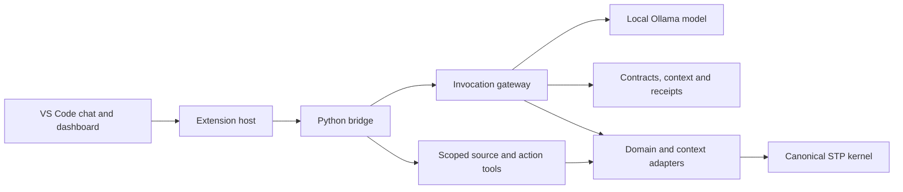

# Sutra 0.29.1 — bounded review output and adaptive reasoning

Adaptive now starts workspace generation at the lowest known reasoning control. Architecture writers, child reviewers and report checkers record that choice and recheck capabilities before dispatch. Report prompts scale detail to supplied evidence, with explicit character limits. A truncated answer stays quarantined; at most one shorter regeneration can use an already allocated review attempt. Every attempt remains charged. Explicit On and Model default preferences remain unchanged. See [validation](docs/validation-0.29.1.md).

Memory admission now credits only reusable weights for an exactly matched loaded model, while preserving working-memory margins and the system reserve. Auto workspace reviews and coding workflows can try a smaller configured model after a capacity refusal before inference. Fresh paging and all protocol checks run again; context, permissions, completed children and consumed budgets remain intact. The STP kernel is unchanged. See [runtime allocation and fallback](docs/runtime-allocation.md).

## Unified memory faults and retention

A shared lifecycle layer now classifies page faults, preserves dependency-safe eviction, restores exact conversation pages from verified receipts and records bounded working-set diagnostics. Sutra Monitor shows context memory alongside runtime resources. Paused workflows retain permissions, completed children and consumed budgets across reloads and model switches. The STP kernel is unchanged. See [memory lifecycle](docs/memory-lifecycle.md).

# Sutra 0.27.0 — observe-only task commitments

Workspace tasks can now record what the routing model understands and what it plans to deliver, then collect the worker’s assessment against those criteria. The original prompt and host constraints remain authoritative. Native chat and Sutra Monitor display these as unverified observations. See [task commitments](docs/task-commitments.md) for scope, evidence and limitations.

# Sutra

The 0.28.1 display fixes are included: native thinking blocks require actual reasoning text from the model; metadata-only calls show **call details** instead. Source mapping, workflow progress and resource pauses are labelled as host status. A resource stop is not a model answer.

Sutra 0.26.1 clarifies workspace routing for architecture and onboarding requests, replaces the raw schema in the prompt with a compact writing guide, and shows the effective reasoning setting in **Sutra Monitor**. The full decoder and host schema remain enforced. Protocol admission is explicitly distinct from task completion or answer correctness.

Sutra 0.26.0 gives conversation models a task-focused prompt while the host
retains the full contract and attaches context identity to admitted responses.
Missing-context requests must name a Smriti page or ask a specific question.
A narrow compatibility adapter fixes escaped-text truncation in the tested
Ollama 0.40.16 MLX structured decoder; strict host validation remains in place.
Adaptive reasoning keeps routine chat fast and selects supported effort for
explicit reasoning, numeric planning, code analysis and fenced structured results before bounded escalation.
Existing settings, permissions, consumed budgets and the STP kernel are preserved.
See [prompt and reasoning policy](docs/adaptive-reasoning.md) for scope and limits.

Sutra 0.21.3 supplies architecture reviewers with a fresh inventory across mapped source partitions, budgeted implementation excerpts, and available child answers. Empty optional memory pages and the absence of harness-created artifacts no longer imply absent repository source. Review context follows installed model capacity within remaining task/ancestor allocations, with room for bounded repairs. The response labels exactly how many mapped files, excerpt files and child reports were delivered. This remains a bounded architecture review, not an exhaustive semantic audit of every file.

Sutra retains separate diagnostics for every routing, child and workspace-review call. Click a **call details** link in chat or **Open call details** in Sutra Monitor. The read-only pane updates during generation and stays available after a reload within the retention window. Native thinking requires a returned reasoning stream; VS Code controls how its inline blocks are grouped.

Sutra 0.21.1 fixes same-chat workspace handoff: tool-free conversation-stage restrictions no longer describe the whole harness. Known false file-access refusals go through bounded repair. Verified conversation history from released 0.20.x and 0.21.0 policies remains available after reload; old action authority is not restored. Workspace arming, scope and remaining budgets still apply.

Sutra 0.21.0 streams local-model reasoning separately from accepted answers. Open **Sutra Monitor → Calls & reasoning** for expandable parent/child details, their model, status and final token usage. Compatible VS Code hosts also show native thinking parts inline; hosts without that capability use the Monitor. Choose **Sutra → Settings → Model reasoning**, then save runtime settings, to request reasoning on (lowest supported level) or model defaults. Adaptive is the default for new configurations; existing choices are preserved and some models always reason.

Reasoning is unverified diagnostic text, never a task-memory page, permission, test proof or accepted answer. Reasoning and answers share the existing output allocation. Ollama supplies total output counts, not separate reasoning-token counts. Diagnostic history is saved locally as plain text in the extension’s per-workspace `reasoning.json`, bounded to 12 calls, 7 days, 1 MiB and 16,000 characters per call. It may include source references emitted by the model. This is separate from Smriti/task memory and immutable protocol evidence. A window closing mid-call is shown as interrupted, never as completed. Retention errors appear in the Monitor without aborting governed work. Older vanished reasoning cannot be recovered; previous versions omitted response bodies from disk traces.

Local model orchestration for VS Code. Switch models while keeping the task,
constraints and accepted context in a local ledger.

Sutra was previously called **Karma**. The **0.16.0** release changed the public name
while retaining the extension identity and stored settings. This is an
experimental local tool, not a guarantee that model answers are correct.

## Use it

1. Install the VSIX in VS Code using **Extensions: Install from VSIX**, then reload.
2. Start Ollama and install the local models you want to use. Python 3.9+ is
   required for the harness.
3. Run **Sutra: Configure Local Models**. Choose the low, mid and high tiers from
   installed models.
4. Run **Sutra: Open Governed Chat (Sutra Auto)**. This saves the compatible Local
   chat and model selection for new chats. Existing chats retain their selection.
5. Chat normally. For workspace access, use **Sutra: Arm Workspace Access**. One confirmation enables reading without opening a new chat. A pending workspace request resumes immediately after approval. The first
   workspace prompt creates or resumes a task; scoped edits and tests request
   additional permissions when needed, followed by confirmation of the exact action.

The native model picker offers **Sutra Auto**, **Sutra Low**, **Sutra Mid** and
**Sutra High**. The review participant is **@sutra**. The dashboard has Overview,
Chat, Usage, Settings and Tools views.

### Governed orchestration

Native chat uses a persisted host state machine for classification, user grants,
source mapping, child reviews, joins, synthesis and action settlement. The UI
sends events; model output cannot create or widen permissions. The adapter proposes
source partitions from measured file/call counts and remaining allocations. The
unchanged STP kernel admits or stops the proposed work.

Children run sequentially in the same request. Each has a reserved share of its
parent budget, an immutable context binding and a narrower read scope. Their fresh
calls receive the full contract and a budgeted Smriti working set. Failed calls
consume allocation. Model switches and reloads cannot reset that use. Source
versions and child receipts are checked again before synthesis.

After interruption, choose a Sutra tier and send **continue** to resume the saved
workflow. A different prompt cancels its unused child reservations; consumed
budget and evidence remain. Reloading still requires arming workspace access.
The monitor shows request/child states, model assignments and allocation use.

This version branches read-only reviews. Editing and tests remain governed parent
actions with exact-action confirmation. Local children are sequential, not parallel
inference. Source partitions do not prove semantic independence; reviewers explain
bounded excerpts and static relationships, not every function's correctness.
The host's role/source/permission validators remain necessary alongside the kernel.

### Combined monitor

Click **Sutra Monitor** in the status bar, or run **Sutra: Open Monitor**.
The dashboard opens in the bottom panel beside Terminal and Output, so it can
stay visible alongside chat and code. `@sutra /usage` opens the same view.

CPU/GPU temperatures, CPU usage, memory, kernel decisions and checkpoint status
appear above token history. Expired hardware readings clear automatically. Each
kernel check is shown separately; a resource ALLOW does not grant task permission.
Temperature readings remain advisory. Expand diagnostics for normalized signals.

Input/output cards, recent-call charts and stage breakdowns update from local
receipts. Filter by model, stage, outcome or time; expand individual calls for
budget allocations. Counts appear when each call finishes. Missing counts are
marked unknown, and filters apply to the latest 250 workspace calls. Viewing
usage never invokes a model. The original editor dashboard also links here.
The previous **Sutra: Open Token Usage** command remains an alias.

VS Code compacts its assembled conversation when its context budget is tight.
Sutra preserves an authenticated checkpoint for recognized compaction requests;
it does not send those requests to Ollama. See [context and compaction](docs/context-and-compaction.md)
for model-specific allocations, verbatim recent turns, pinned quotations and older-page retrieval. The working note is still unverified and retrieval is not a guarantee of semantic recall.

A ready or armed badge does not prove that every VS Code prompt uses Sutra.
Check the selected model and the response's invocation details. Direct Ollama
models and other providers can bypass this harness.

## What is included

- Fresh, scoped source discovery and paging; deterministic Python/TypeScript maps.
- Local model routing, API-map review, bounded repair and checkpoint quarantine.
- Governed Python edits and test process execution, with immutable receipts.
- Conversation checkpoints that survive supported native chat compaction and
  model switches without replaying the full transcript to each model.
- Offline diagrams and input/output token accounting by invocation and stage.
- Resource and budget monitoring with separate Karma/domain and Smriti/context
  adapters using one unchanged STP kernel.

## Architecture



The kernel decides **ALLOW**, **BRIDGE**, **FIN** or **COMPOUND_FIN** from normalized
measurements. Adapters validate inputs and apply domain rules; the kernel does
not assess the truth of a model's prose. Its pinned SHA-256 is:

```
9dfef2479b9af1b8f82282597f13b1205c31b19ba4ff52f60e305f1757ed4eac
```

## Development and tracking

See [development instructions](docs/development.md), [release notes](CHANGELOG.md)
and [known limitations](docs/known-limitations.md). The imported Karma 0.15.1
baseline remains a separate commit; `v0.16.0` records the Sutra rebrand.

Build an offline VSIX with `python3 -B package.py --output dist`.
Generated packages, local databases, logs and conversation traces are ignored by
Git. Commit source changes deliberately; Git does not automatically record edits.

Compatibility identifiers such as `deepak-local.karma-local-harness`, `karma.*`
settings/commands, model IDs and signed receipt URLs are intentionally retained.
They preserve existing settings, storage and conversation pointers. Do not rename
them without an explicit migration.

This repository does not grant an open-source license for original project code.
Bundled third-party components retain their own licenses; see
[third-party notices](THIRD_PARTY_NOTICES.md).

Current release: **0.25.0**. Auto begins new requests with the configured low tier. Requested conversation pages are loaded before model escalation; stronger models keep the same original request, pinned context, permissions and spent allocation. Explicit tier selections remain fixed. Workspace worker selection follows fresh scoped source retrieval. New messages reach conversation routing even while a review is saved. Greetings do not resume or restart reviews. A new workspace request asks before replacing saved work. Python source mapping uses the page work allocation rather than the small API packet limit. Mapping pauses show their causes and coverage in chat, with file diagnostics in Sutra Monitor. Saved requests have explicit Resume/Discard controls in Sutra Monitor. Resume focuses the existing chat without changing its draft; send **continue** using a Sutra model to resume. Other messages remain separate. Stop retains context, receipts and consumed allocation. A budget-limited resume can pause again; it does not allocate a new budget.
