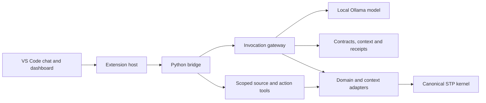

# Sutra 0.45.0 — Opt-in Strata High

Ollama supplies the default model choices and the Low and Mid tiers. Strata
is an experimental option for High in native chat and read-only workspace
reviews. Sutra uses its existing invocation gateway, source and budget checks,
and local resource gate. The Strata server must already have its model loaded.

1. Start your Strata server on `127.0.0.1`. Open its `/v1/status` endpoint and
   note the server port and the exact `model` value.
2. In VS Code **User Settings**, set **Karma › Strata: Port** (`karma.strata.port`)
   and **Karma › Strata: Model** (`karma.strata.model`). Leave authentication
   tokens in the extension host's `SUTRA_STRATA_API_KEY` environment variable
   if your local server requires one.
3. Run **Sutra: Configure Local Models** and refresh the models. Select
   **strata:high** in High, then save. Pick **Sutra High** in chat for a fixed
   route, or **Sutra Auto** to use the configured tiers when the workflow routes
   to them. Use an Ollama tier for edits or tests.
4. To return High to Ollama, select an Ollama model and save. Set the Strata
   port to `0` to disable Strata discovery.

For launch-time configuration, `SUTRA_STRATA_PORT` and `SUTRA_STRATA_MODEL`
apply when the corresponding User Settings are unset.
`SUTRA_STRATA_CONTEXT` can cap Sutra's context allocation. Strata's buffered
structured replies still undergo Sutra's schema and role checks, and
incremental Strata memory use is uncalibrated.

## Sutra 0.44.1 — Recover child allocations

Read-only workspace reviews can save a child's findings and next step before
continuing its partition. On a timeout or output-limit pause, select a tier
and send `continue` in the same chat to finish the saved slice. If the packet
only fits with one attempt reserved, Sutra can run that attempt within the
existing child allocation. **Increase allocation** in Sutra Monitor can add a
measured shortfall to a paused child and its parent execution. Checkpoints,
read scope and recorded spending stay with the review.

# Stage long document reviews

Ask Sutra Auto to review a named workspace DOCX and approve its read. Sutra
splits extracted text above 24 KiB into sections, up to 96 KiB total, and
records source quotations from each section. Auto starts synthesis on Low and
checks its answer against those quotations. It can retry synthesis on a higher
configured tier after an unsupported conclusion, within the same approval and
task allocation. The evidence assessment is a model judgment. A fixed model
tier runs extraction and synthesis with the selected model.

# Sutra 0.42.1 — Isolate chat and document context

A native chat restores receipts that belong to its workspace and conversation.
Approving a new named DOCX starts a document-specific working set. Reviewing the
same approved snapshot can carry forward its earlier review turns.

# Sutra 0.42.0 — Resolve implicit document follow-ups

Ask a follow-up in the chat that reviewed a document. When one approved
snapshot is eligible, the classifier can request it using an identifier.
The host verifies the selection before providing the snapshot for the answer.
An unclear target can trigger a question. Named files use scoped approval.

# Sutra 0.41.3 — Resolve absolute DOCX paths in the workspace

Ask for an opinion on a named DOCX using an absolute or relative path in the
active workspace. Sutra resolves the path before requesting a scoped read.
Continue the saved request in its original chat to recover from an earlier
request for pasted text.

# Sutra 0.41.2 — Continue an approved document review

A follow-up about the same document in the original Sutra chat can reuse the
approved snapshot across reloads and model changes. Name a new file to request
a separate read. Résumé feedback uses documented figures or explicit placeholders.

# Sutra 0.41.1 — Review named workspace documents

Name a DOCX in Sutra Auto to review its text. Sutra looks for the file in the
active workspace folder and asks before reading it. When names match more than
one file, choose the intended path. The saved evidence request can resume in the
same chat after approval. **Document text:** remains available for pasted excerpts.

# Sutra 0.41.0 — Resume when evidence arrives

When a review needs a document or a source target, Sutra pauses the request.
In the same chat, paste the relevant résumé section below **Document text:**
or resolve a missing source scope with **Use this workspace** or
**Workspace files:** followed by one relative path per line. The saved request
continues across reloads and model changes with its existing context and spending.
Workspace access still follows the workspace's authorization settings.

# Sutra 0.40.1 — Route document reviews in chat

Sutra asks for the text when a résumé, CV, or cover letter is referenced but
its content is missing. Paste a section below a separate **Document text:**
heading in Sutra Auto to review it in chat.

# Sutra 0.40.0 — Open tasks in native chat

A new workspace request can park the focused task and start with its own goal
and scope. Use **Open tasks** in Sutra Monitor or **Sutra: Open Tasks** in the
Command Palette to focus, resume, or close a task from the last active Sutra
chat. Finishing or closing the focused task restores focus to the previous
open task. Send **continue** in the originating chat to resume it, using
whichever Sutra model tier you want to run next.

Each task retains its workflow checkpoint, Smriti memory references, permissions
and consumed allocation across reloads. Resuming revalidates the source and
permission binding. Saved edits and tests still require action confirmation.

# Sutra 0.39.0 — Adaptive thinking and fixed-tier settings

Adaptive requests the model’s lowest supported positive reasoning level for substantive conversation. Sutra looks for request cues such as debugging supplied code, numerical planning, comparing approaches or explaining trade-offs, and explicit requests to reason. Routine or unclassified chat starts at the lowest known level. This check runs in the host without another model call.

During a workspace review, Sutra uses fresh evidence and the stage’s allocation. A report writer synthesizing multiple files can use thinking when the existing allocation has the full output reserve and a spare draft attempt. Adaptive evidence selection, child reviews and claim checks start at the lowest known level. If thinking exhausts the report writer’s output reserve, Sutra can use an existing attempt to retry at the lowest level.

Run **Sutra: Configure Reasoning**. The shared setting applies to **Sutra Auto**. Each fixed tier pins its configured model and can **Inherit** the shared choice or use **Adaptive**, **On**, **Off**, or **Model default**. The Chat title bar lightbulb requests thinking for one turn. Open a call’s details to see which control Sutra actually requested.

# Sutra 0.38.5 — start in chat and recover reviews where they stop

Use **Sutra: Open Chat (Sutra Auto)** to start in VS Code's native Local Chat. Ask for a review and describe the scope you want. Sutra asks for workspace access when needed, then discovers and reads relevant files.

The advanced architecture review proceeds from inspection to report. If it needs evidence from another file, **Read another file and retry** uses the review's existing scope and remaining budget.

When a native request pauses, choose **Resume this request** in the original chat or **Resume** in Sutra Monitor. Both submit a continuation through Sutra Auto. To resume using a specific model tier, select it and send **continue** in the original chat.

Sutra Monitor shows why a review stopped and which recovery actions are available. The dashboard also improves keyboard navigation, form labels and control contrast.

# Sutra 0.38.4 — verify protocol events and explain review stops

Sutra checks protocol events against their hash-chained audit copies. New events include host timestamps. Architecture preflight stops appear in the review panel and Sutra Monitor.

The review panel shows catalog exclusions and the remaining repository operations. Catalog scans use one operation each. Sutra verifies the current budget and contract when it commits an operation and checks replay identity before returning a receipt. When source evidence is short and the repository budget is exhausted, the review reports a terminal stop.

Headless admission can refresh missing or expired telemetry with the bundled sampler on supported hosts.

# Sutra 0.38.3 — recover an architecture review step

The **Sutra: Review Codebase** workflow checks for enough current source evidence before requesting a report. It can reuse settled reads even if earlier model notes omitted them. If an architect call reaches its output limit, Sutra can spend one existing retry with thinking off, keeping the prior checkpoint and read receipts. A read continuation must match a cursor issued for that file.

# Sutra 0.38.2 — resume an interrupted claim review

If the architecture claim reviewer reaches its output limit with thinking enabled and a retry available, Sutra pauses with the draft, completed reviews, source evidence and consumed budget saved. Choose **Resume** in Sutra Monitor, then send **continue** in chat. Sutra requests thinking off for the unfinished page and checks that the saved source evidence is current.

# Sutra 0.38.1 — thinking for one chat request

Click the lightbulb in the VS Code Chat title bar, or run **Sutra: Think on Next Request** from the Command Palette. This requests thinking for one Sutra turn even with Adaptive selected. Click the lit bulb or run **Sutra: Cancel Thinking for Next Request** before sending to cancel. Later requests use your saved reasoning setting. Sutra shows thinking inline when the local model streams it.

# Sutra 0.38.0 — Git provenance and targeted architecture evidence

Architecture reviews record the open checkout's commit, branch and working tree status before reviewing source. Upstream status uses local tracking data and is labeled accordingly. A request for the latest upstream version asks you to confirm the open snapshot or open the intended checkout. Sutra checks the snapshot again before it publishes the report.

The review can request up to four precise source excerpts in one follow-up round. The host checks each requested path and line against the workspace scope and admitted plan, charges the active allocation, and verifies source against the read receipts before publication. Evidence selection uses the lowest advertised reasoning setting. The final review uses your configured setting.

# Sutra 0.37.0 — automatic allocation within workspace limits

Read-only native reviews can draw from a workspace reserve when the host measures a shortfall. The reserve uses cumulative ceilings per review. The defaults are 128 MiB of source, 2,000 repository operations, 80 model calls, 500,000 model budget units and 3,600 seconds. An approved draw increases the working allowance, preserves previous spending and creates a linked bounded execution. Sutra revalidates any source receipts it carries forward.

Use the User setting **Sutra: Workspace Allocation** to override these ceilings or disable automatic draws. The setting accepts `enabled`, `source_bytes`, `operations`, `calls`, `tokens`, `seconds` and a `byFolder` map keyed by the local workspace root. Each folder override accepts those same six policy fields. Workspace files cannot grant reserve authority. Explicit overrides outside the automatic ceiling still use **Sutra: Increase Task Allocation**.

# Sutra 0.36.0 — source budget recovery on saved reviews

Sutra checks the pinned task, constraints and conversation against the selected model's context before opening source for a review call. After a pause, it can reuse a settled source snapshot for the same saved execution after checking the current file bytes. Changed files need fresh analysis within the remaining allocation.

Work started under an older policy uses the explicit review restart. If the old review has already spent its source allocation and has no eligible snapshot, increase the task's allocation in Sutra Monitor before restarting. Previously consumed work remains recorded.

# Sutra 0.35.0 — persistent workspace permissions

Choose **Sutra: Workspace Permissions…** from the Command Palette or pick a profile the first time native chat needs project files. **Read only** enables scoped reads. **Workspace agent** also enables scoped edits and sandboxed tests with the existing action approval flow. Optional tools have their own approval policy.

Sutra restores the profile when you reload a trusted workspace or switch models. Use **Sutra: Revoke Workspace Access** to remove it. Paused requests retain their context, task constraints and consumed budget. Send **continue** to resume a saved request.

# Sutra 0.34.0 — bounded execution sessions and fresh source paging

Workspace requests now have a fixed execution allowance inside the cumulative task budget. Retries, reloads and model switches preserve that allowance, memory and permissions. A later execution uses only the task capacity that remains; an explicit increase creates a linked successor without erasing spending.

Before asking for more capacity, mapping and synthesis select smaller fresh source pages and disclose deferred files. The monitor shows execution spending and paging alongside cumulative task totals. The canonical STP kernel remains unchanged. See [execution sessions](docs/execution-sessions.md) and [validation](docs/validation-0.34.0.md).

# Sutra 0.33.0 — registered tools with governed installation

Sutra can now request Ruff lint checks and Pyright type checks from native chat. Ask “Run Ruff on code.py” or “Check code.py with Pyright.” The host offers installation if needed, then a separate source-check approval. **Sutra: Manage Tools** opens the catalog. Sutra Monitor provides **Manage tools** and **Tool permissions** buttons.

Use **Sutra: Configure Tool Policy** to choose Ask each time, Preapprove selected operations, or Disable optional tools. A preapproval requires one explicit confirmation of the workspace, operation list and registry identity; changing that policy or registry requires confirmation again. A repository settings file cannot grant itself authority. Workspace permissions and optional tool approvals are separate.

The first registry pins Ruff 0.17.5 and Pyright 1.1.414 to official package URLs and integrity hashes. Installation uses Sutra storage, without package-manager scripts or changes to project dependencies. Checks use fresh, approved Python snapshots in the macOS sandbox, with no network, source writes, fixes or project configuration. Other platforms have package mappings, but execution currently fails closed until a sandbox adapter is implemented and tested.

Tool operations reserve task/ancestor capacity and retain consumed charges through interruption and model changes. Receipts and paged diagnostic evidence use the existing Smriti store. Lost replies recover from receipts without replay; a newly approved reinstall quarantines an unverified prior copy. The canonical STP kernel is byte-for-byte unchanged. See [tool permissions and operation limits](docs/capabilities.md) and [validation](docs/validation-0.33.0.md).

# Sutra 0.32.0 — paged architecture claim reviews

Architecture reports now receive a separate claim review in context-sized pages. Each page carries complete claims and host-generated evidence IDs bound to exact source text, paths and line locations. The reviewer selects IDs instead of copying quotes. All relevant claim/evidence pairs must be reviewed before publication; a contradiction on any page withholds that claim. Source IDs prove provenance, not correctness.

Accepted pages and the original draft survive interruption. Retrying the same request can continue unfinished review pages with another configured model, after fresh source, contract and reviewer-identity checks. Completed pages are not replayed. Each page has at most two total attempts across restarts; every dispatch still needs context, resource and remaining task allocation. Model changes never refund consumed budgets or grant permissions. Source-linked IDs appear in the report; detailed page judgments remain available in review details.

The canonical STP kernel is unchanged. This is a bounded review of the writer's supplied excerpts, not an exhaustive semantic review of every mapped file. Claims requiring evidence spread across pages can remain unsupported. A smaller model must fit each saved page; saved plans are not silently rewritten to drop context.

# Sutra 0.31.0 — explicit task allocation recovery

When a saved review pauses because its task/context allocation is too small, open Sutra Monitor and choose Increase allocation… (or run Sutra: Increase Task Allocation). Review the added capacity and new totals in the confirmation dialog. Approval preserves the original task, constraints, context and all consumed spending; send continue in the same chat afterward. If an extension update requires Restart review, accept that separate recovery choice to read source afresh.

Allocation approval does not start inference, grant file permissions, enable reasoning, or override hardware/model capacity. The model cannot raise its own budget. Monitor shows spent/total amounts and the amendment version.

See [allocation recovery and protocol boundaries](docs/allocation-recovery.md).

The local model receives a versioned task-facing packet: the request, relevant requirements, fresh evidence, available action choices and Smriti memory. Governance identities, resource decisions, budget records and constraint echoes remain in the host. The gateway binds the exact projected packet to its dispatch permit and attaches host metadata only after checking the raw model response. Host-bound metadata is explicitly labelled; it is not a model acknowledgement or proof of compliance.

Every new call reserves its conservative model-input charge and output allowance before dispatch. Completed backend counts settle the task and ancestor charge, including failed or withheld generations. Only unused reservation is released; missing measurements, interruptions and historical calls retain their original reservation. See [model boundary and accounting](docs/model-boundary.md) and [validation](docs/validation-0.30.0.md). The STP kernel remains byte-for-byte unchanged.

# Sutra 0.29.1 — bounded review output and adaptive reasoning

Adaptive now starts workspace generation at the lowest known reasoning control. Architecture writers, child reviewers and report checkers record that choice and recheck capabilities before dispatch. Report prompts scale detail to supplied evidence, with explicit character limits. A truncated answer stays quarantined; at most one shorter regeneration can use an already allocated review attempt. Every attempt remains charged. Explicit On and Model default preferences remain unchanged. See [validation](docs/validation-0.29.1.md).

Memory admission now credits only reusable weights for an exactly matched loaded model, while preserving working-memory margins and the system reserve. Auto workspace reviews and coding workflows can try a smaller configured model after a capacity refusal before inference. Fresh paging and all protocol checks run again; context, permissions, completed children and consumed budgets remain intact. The STP kernel is unchanged. See [runtime allocation and fallback](docs/runtime-allocation.md).

## Unified memory faults and retention

A shared lifecycle layer now classifies page faults, preserves dependency-safe eviction, restores exact conversation pages from verified receipts and records bounded working-set diagnostics. Sutra Monitor shows context memory alongside runtime resources. Paused workflows retain permissions, completed children and consumed budgets across reloads and model switches. The STP kernel is unchanged. See [memory lifecycle](docs/memory-lifecycle.md).

# Sutra 0.27.0 — observe-only task commitments

Workspace tasks can now record what the routing model understands and what it plans to deliver, then collect the worker’s assessment against those criteria. The original prompt and host constraints remain authoritative. Native chat and Sutra Monitor display these as unverified observations. See [task commitments](docs/task-commitments.md) for scope, evidence and limitations.

# Sutra

The 0.28.1 display fixes are included: native thinking blocks require actual reasoning text from the model; metadata-only calls show **call details** instead. Source mapping, workflow progress and resource pauses are labelled as host status. A resource stop is not a model answer.

Sutra 0.26.1 clarifies workspace routing for architecture and onboarding requests, replaces the raw schema in the prompt with a compact writing guide, and shows the effective reasoning setting in **Sutra Monitor**. The full decoder and host schema remain enforced. Protocol admission is explicitly distinct from task completion or answer correctness.

Sutra 0.26.0 gives conversation models a task-focused prompt while the host
retains the full contract and attaches context identity to admitted responses.
Missing-context requests must name a Smriti page or ask a specific question.
A narrow compatibility adapter fixes escaped-text truncation in the tested
Ollama 0.40.16 MLX structured decoder; strict host validation remains in place.
Adaptive reasoning keeps routine chat fast and selects supported effort for
explicit reasoning, numeric planning, code analysis and fenced structured results before bounded escalation.
Existing settings, permissions, consumed budgets and the STP kernel are preserved.
See [prompt and reasoning policy](docs/adaptive-reasoning.md) for scope and limits.

Sutra 0.21.3 supplies architecture reviewers with a fresh inventory across mapped source partitions, budgeted implementation excerpts, and available child answers. Empty optional memory pages and the absence of harness-created artifacts no longer imply absent repository source. Review context follows installed model capacity within remaining task/ancestor allocations, with room for bounded repairs. The response labels exactly how many mapped files, excerpt files and child reports were delivered. This remains a bounded architecture review, not an exhaustive semantic audit of every file.

Sutra retains separate diagnostics for every routing, child and workspace-review call. Click a **call details** link in chat or **Open call details** in Sutra Monitor. The read-only pane updates during generation and stays available after a reload within the retention window. Native thinking requires a returned reasoning stream; VS Code controls how its inline blocks are grouped.

Sutra 0.21.1 fixes same-chat workspace handoff: tool-free conversation-stage restrictions no longer describe the whole harness. Known false file-access refusals go through bounded repair. Verified conversation history from released 0.20.x and 0.21.0 policies remains available after reload; old action authority is not restored. Workspace arming, scope and remaining budgets still apply.

Sutra 0.21.0 streams local-model reasoning separately from accepted answers. Open **Sutra Monitor → Calls & reasoning** for expandable parent/child details, their model, status and final token usage. Compatible VS Code hosts also show native thinking parts inline; hosts without that capability use the Monitor. Choose **Sutra → Settings → Model reasoning**, then save runtime settings, to request reasoning on (lowest supported level) or model defaults. Adaptive is the default for new configurations; existing choices are preserved and some models always reason.

Reasoning is unverified diagnostic text, never a task-memory page, permission, test proof or accepted answer. Reasoning and answers share the existing output allocation. Ollama supplies total output counts, not separate reasoning-token counts. Diagnostic history is saved locally as plain text in the extension’s per-workspace `reasoning.json`, bounded to 12 calls, 7 days, 1 MiB and 16,000 characters per call. It may include source references emitted by the model. This is separate from Smriti/task memory and immutable protocol evidence. A window closing mid-call is shown as interrupted, never as completed. Retention errors appear in the Monitor without aborting governed work. Older vanished reasoning cannot be recovered; previous versions omitted response bodies from disk traces.

Local model orchestration for VS Code. Switch models while keeping the task,
constraints and accepted context in a local ledger.

Sutra was previously called **Karma**. The **0.16.0** release changed the public name
while retaining the extension identity and stored settings. This is an
experimental local tool, not a guarantee that model answers are correct.

## Use it

1. Install the VSIX in VS Code using **Extensions: Install from VSIX**, then reload.
2. Start Ollama and install the local models you want to use. Python 3.9+ is
   required for the harness.
3. Run **Sutra: Open Chat (Sutra Auto)**. This saves the compatible Local
   chat and model selection for new chats. Existing chats retain their selection.
4. Chat normally. The first request that needs project files offers **Read only** or **Workspace agent** permissions and continues in the same chat after approval. Sutra remembers the choice for this trusted workspace across reloads, updates and model changes. Workspace agent access lets Sutra request file scopes for edits and local tests, then confirm each exact action. Manage or revoke access from **Sutra: Workspace Permissions…** or the dashboard.

Sutra discovers installed models and fills empty tiers. Use **Sutra: Configure
Local Models** to change those choices. **Sutra Low**, **Sutra Mid** and
**Sutra High** are explicit overrides in the native model picker. Open **Sutra
Monitor** for recovery and diagnostics, or the dashboard's **Tools** for
advanced review and calibration controls.

### Governed orchestration

Native chat uses a persisted host state machine for classification, user grants,
source mapping, child reviews, joins, synthesis and action settlement. The UI
sends events; model output cannot create or widen permissions. The adapter proposes
source partitions from measured file/call counts and remaining allocations. The
unchanged STP kernel admits or stops the proposed work.

Children run sequentially in the same request. Each has a reserved share of its
parent budget, an immutable context binding and a narrower read scope. Their fresh
calls receive the full contract and a budgeted Smriti working set. Failed calls
consume allocation. Model switches and reloads cannot reset that use. Source
versions and child receipts are checked again before synthesis.

After interruption, choose **Resume this request** in the original chat. To
choose a different model explicitly, select a Sutra tier and send **continue**
there. Replacing the saved request requires confirmation and releases unused child
reservations. The saved task retains its constraints, consumed budget and
evidence. Saved workspace permissions are checked again when work resumes.
The monitor shows request/child states, model assignments and allocation use.

This version branches read-only reviews. Editing and tests remain governed parent
actions with exact-action confirmation. Local children are sequential, not parallel
inference. Source partitions do not prove semantic independence; reviewers explain
bounded excerpts and static relationships, not every function's correctness.
The host's role/source/permission validators remain necessary alongside the kernel.

### Combined monitor

Click **Sutra Monitor** in the status bar, or run **Sutra: Open Monitor**.
The dashboard opens in the bottom panel beside Terminal and Output, so it can
stay visible alongside chat and code. `@sutra /usage` opens the same view.

CPU/GPU temperatures, CPU usage, memory, kernel decisions and checkpoint status
appear above token history. Expired hardware readings clear automatically. Each
kernel check is shown separately; a resource ALLOW does not grant task permission.
Temperature readings remain advisory. Expand diagnostics for normalized signals.

Input/output cards, recent-call charts and stage breakdowns update from local
receipts. Filter by model, stage, outcome or time; expand individual calls for
budget allocations. Counts appear when each call finishes. Missing counts are
marked unknown, and filters apply to the latest 250 workspace calls. Viewing
usage never invokes a model. The original editor dashboard also links here.
The previous **Sutra: Open Token Usage** command remains an alias.

VS Code compacts its assembled conversation when its context budget is tight.
Sutra preserves an authenticated checkpoint for recognized compaction requests;
it does not send those requests to Ollama. See [context and compaction](docs/context-and-compaction.md)
for model-specific allocations, verbatim recent turns, pinned quotations and older-page retrieval. The working note is still unverified and retrieval is not a guarantee of semantic recall.

The status bar shows workspace access. Check for a Sutra model beneath the
prompt and invocation details in its response to confirm routing.

## What is included

- Fresh, scoped source discovery and paging; deterministic Python/TypeScript maps.
- Local model routing, API-map review, bounded repair and checkpoint quarantine.
- Governed Python edits and test process execution, with immutable receipts.
- Conversation checkpoints that survive supported native chat compaction and
  model switches without replaying the full transcript to each model.
- Offline diagrams and input/output token accounting by invocation and stage.
- Resource and budget monitoring with separate Karma/domain and Smriti/context
  adapters using one unchanged STP kernel.

## Architecture



The kernel decides **ALLOW**, **BRIDGE**, **FIN** or **COMPOUND_FIN** from normalized
measurements. Adapters validate inputs and apply domain rules; the kernel does
not assess the truth of a model's prose. Its pinned SHA-256 is:

```
9dfef2479b9af1b8f82282597f13b1205c31b19ba4ff52f60e305f1757ed4eac
```

## Development and tracking

See [development instructions](docs/development.md), [release notes](CHANGELOG.md)
and [known limitations](docs/known-limitations.md). The imported Karma 0.15.1
baseline remains a separate commit; `v0.16.0` records the Sutra rebrand.

Build an offline VSIX with `python3 -B package.py --output dist`.
Generated packages, local databases, logs and conversation traces are ignored by
Git. Commit source changes deliberately; Git does not automatically record edits.

Compatibility identifiers such as `deepak-local.karma-local-harness`, `karma.*`
settings/commands, model IDs and signed receipt URLs are intentionally retained.
They preserve existing settings, storage and conversation pointers. Do not rename
them without an explicit migration.

This repository does not grant an open-source license for original project code.
Bundled third-party components retain their own licenses; see
[third-party notices](THIRD_PARTY_NOTICES.md).

Sutra Auto begins new requests with the configured low tier. Requested conversation pages are loaded before model escalation; stronger models keep the same original request, pinned context, permissions and spent allocation. Explicit tier selections remain fixed. Workspace worker selection follows fresh scoped source retrieval. New messages reach conversation routing even while a review is saved. Greetings stay conversational. A new workspace request asks before replacing saved work. Mapping pauses show their causes and coverage in chat, with file diagnostics in Sutra Monitor. Resume submits the saved request in the originating chat and keeps its draft. Stop retains context, receipts and consumed allocation. A budget-limited resume can pause again.
