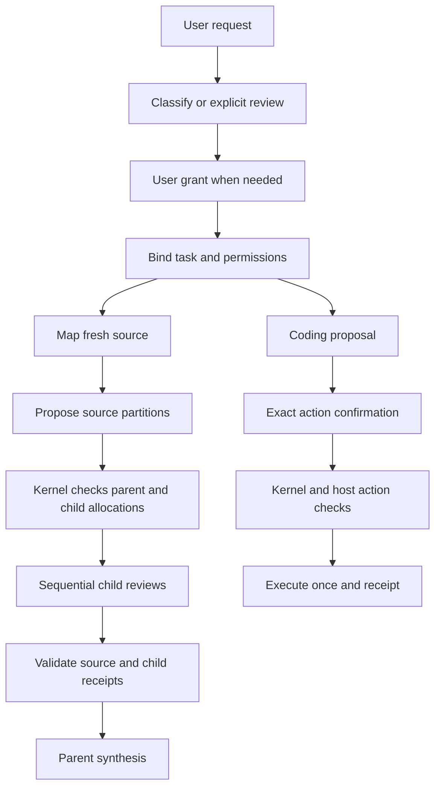

# Orchestration boundary

`harness/orchestration.py` owns the persisted state graph, effect admission,
lineage, reservations, settlement and joins. `orchestration_flow.py` executes
workflow steps through that graph. Native chat and the review panel send events;
they do not choose the review/coding pipeline or manage child allocation.
`subagent_runtime.py` is the read-only worker adapter. Existing role validators
still check contracts, source provenance, citations and concrete action proposals.

The canonical STP kernel is unchanged. The host proposes source partitions using
file/call counts and remaining allocations. Those are workload measurements, not
verified semantic complexity or proof that partitions are independent. The kernel
admits each proposed reservation and each dispatch. ALLOW permits the checked
operation; BRIDGE/FIN stop an oversized operation; COMPOUND_FIN takes precedence
when an allocation is already exhausted. These decisions cannot grant permissions.

Every model, repository operation and edit/test commitment has an orchestration
owner. Its charge and RUNNING transition commit in the same transaction as the
effect commitment. A receipt settles the node. Child reservations are atomic;
siblings cannot spend one another's allocation. Parent checks include outstanding
child reservations. Completed/cancelled children release only unused allocation.
Model calls charge conservative input plus reserved output, including repairs and
failed calls. The token dashboard separately reports measured Ollama usage.

A child carries immutable parent lineage, contract/calibration/policy bindings,
its assigned source versions and narrower permissions. Large manifests remain in
the ledger, addressed by a checked context handle. The model sees the full task
contract, current source excerpts and a budgeted Smriti working set, including
recent turns and pinned user statements. These statements do not grant tool
permissions. Children cannot edit, run tests, use network tools or widen scope.
Source and receipt checks run again at join and synthesis. A stale or quarantined
child cannot be promoted to evidence. Model summaries remain unverified commentary.

Within a workspace, the bridge lock serializes workflow steps. Children currently
run one at a time. Other workspaces and external Ollama clients may still contend
for hardware. Source is reread for mapping and child dispatch; no source cache is
introduced. Explanations cover bounded excerpts and static relationships, not a
proof of every function's behavior.

After an interrupted native request, `continue` resumes the saved flow with its
original prompt on the selected tier. Arming is required again after reload.
A different prompt cancels unused child reservations but retains consumed budget
and evidence. Recovery reconciles interrupted effect commitments without replaying
edits/tests or refunding failed calls, and reuses committed forks/joins. Task or
calibration changes invalidate outstanding children. Permission changes require a
host-confirmed grant and carry budget use into the next contract epoch.

`DONE` on a workflow means that response or action observation has settled, not
that the user's whole project is proven correct. Coding proposals pass through
AWAITING_ACTION and EXECUTING_ACTION. Test receipts remain process observations;
they are not trusted proof of assertions from model-editable tests.

Open **Sutra Monitor** for workflow/child states, assigned models and allocation
use. The detailed SQLite ledger keeps append-only nodes, transition chains,
charges and settlements. Advanced individual tool commands also enter the same
effect-admission boundary; their domain-specific validators remain in place.
