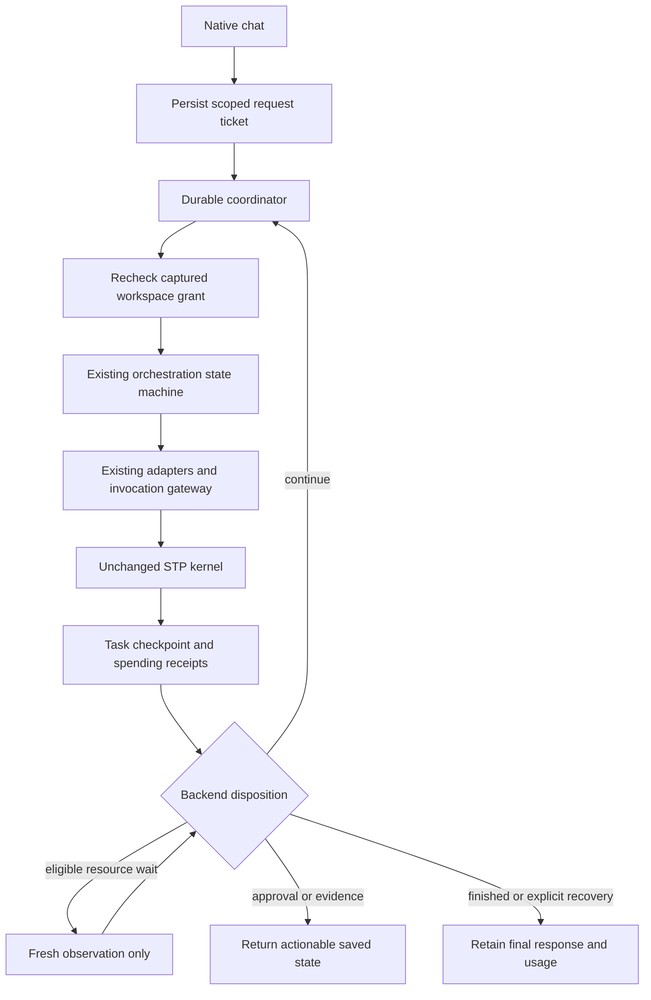

# Durable task continuation

Sutra 0.55.0 advances an authorized workflow outside the chat display. The
existing Python orchestration state machine owns the task disposition. The
coordinator follows that disposition; it cannot create an authorization, select
new task limits or replay an uncertain model call. The canonical STP kernel is
unchanged.

## Binding and admission

Whole-task mode is part of the immutable transport digest. Each following
request carries the same flow, latest receipt cursor, task binding, chat owner,
model selections and captured reasoning environment. Only a small allowlist of
these fields carries forward. Consent, installation authorization and proposed
actions do not carry into generated next-step requests.

The coordinator validates the exact persisted workspace grant bytes before each
stage, readiness probe and final summary. The backend still checks ownership,
contract epochs, policy, source custody, task allocation and hardware admission.
An unchanged runnable checkpoint stops rather than becoming an unbounded retry.

A Karma continuation adapter evaluates the next intent through the unchanged STP
kernel: runnable work can receive ALLOW; resource probes and external decisions
receive BRIDGE; finished, stopped or stale work receives FIN. This transition
permit does not replace the separate source/model cost and hardware admissions.

The permit is an immutable `RUNNER_CONTINUATION_DECISION` entry in the existing
`page_audit` hash chain. It binds the runner request ID, task contract/binding,
flow receipt cursor, continuation fingerprint, next event and kernel frame. Each
automatic request echoes its chained receipt. The backend checks the latest
permit and current task state before effects; a changed Stop, stale checkpoint,
foreign runner or altered receipt cannot authorize a stage. Identical waiting
observations can reuse one immutable permit; a successful readiness transition
records its new observation. Final summary collection is read-only under FIN.

New child recipe 5 also pages unseen gaps above or between previously delivered
function bodies, including imports and globals. A source-frontier adapter checks
authenticated delivery of every authorized nonblank line before BRIDGE can
request a bounded findings/unresolved-check handoff to the parent. This is source
acquisition coverage, not verified model understanding. Earlier recipes retain
their original selection and receipts.

Model and source operations keep their normal gateway reservations and receipts.
The runner does not reset spending, replace task limits, or interpret model
commentary as permission. Automatic allocation remains subject to the previously
approved workspace policy.

## Waits and explicit boundaries

The backend describes runnable stages and known external resource blockers
separately from user decisions and failures. Readiness probing does not load or
unload a model, infer, or inspect project source. A bound successful observation
permits a fresh resume check; readiness is checked again before the workflow
advances. An observation that regresses leaves the same checkpoint waiting.

Probes back off to avoid busy polling. This delay schedules observation, rather
than establishing task progress or authorizing another inference. Unchanged
conditions update one bounded diagnostic snapshot instead of appending a new
audit row for every clock or free-memory change. Changed conditions have an
immutable audit reference. Neither snapshot nor an old ALLOW grants execution.

Permission/evidence requests, allocation beyond approved limits, policy or source
recovery, quarantined output and unresolved execution outcomes remain explicit
boundaries. A missing receipt in this task's lineage cannot become proof that a
retry is safe. Unrelated historical orphans do not block another task's probe;
the global inference slot and dispatch admission remain separately enforced.

## Reload, Stop and model changes

Reloading or closing the chat display detaches the client. The runner retains
authorized intent and can finish later stages without another chat request.
Reconnecting by the original ticket retrieves current progress or the final
result without resubmission. Diagnostic streams have bounded retention; a gap
does not discard task pages, checkpoints or spending receipts.

Live chat Stop and Monitor's Stop runner request cancel the captured task.
Queued stages and scheduled probes are removed. Cancellation of an in-flight
bridge waits for its process to exit before another stage can run. This does not
claim that an external shared provider has completed. Interrupted reservations
remain charged and their outcome stays unverified.

A Stop observed while a chat response is attached ends that response. It cannot
fall through the retained-ticket recovery path and submit replacement work. A
later explicit Continue may recover a ticket that was already cancelled before
that new attachment began.

To change a running task's model, explicitly stop it or wait for an actionable
pause, select the configured tier, and resume the saved task. The next accepted
ticket captures the new environment while retaining the original task, source
checkpoints, constraints, permissions and cumulative spending. A submitted ticket
cannot be rebound to a different environment.

A daemon restart can restore a known queued or waiting checkpoint under the
identical runtime. A journal marked running or cancelling has an unknown outcome
and is not replayed. A different runtime requires explicit saved-task recovery.

## Presentation and telemetry

Host workflow progress is distinct from model reasoning. A final read-only
summary aggregates model usage once, deduplicates invocation IDs and preserves
the initial classifier's conversation-memory anchor. It does not replace the
accepted report with classifier prose. Before cached publication, native chat
checks the current backend workflow identity and cursor.

While an authorized task is pending, the coordinator owns a bounded telemetry
collector independent of VS Code's lifecycle. Private samples live under
`coordinator/telemetry.json`; the UI stream stays separate. Monitoring validates
both streams, uses fresh measurements and retains adverse pressure when fresh
readings conflict. Missing observations do not imply pressure or health.

## Validation

`test/task-runner.cjs` runs real coordinator processes and TCP clients against the
production bridge, orchestration, gateway and temporary ledgers. Its model
transport and hardware samples are deterministic. The matrix covers detached
completion, replay/rebinding rejection, queued/in-flight Stop, revocation,
readiness without inference, safe process restart, invalid continuation bindings,
unknown-outcome stops and explicit model changes with unchanged task limits.

The full QA runner includes these scenarios, native UI contracts, telemetry
tests, browser controls, Python recovery tests, runtime integrity and a packaged
VS Code host check. Live provider measurements are reported separately from the
deterministic regression suite.
