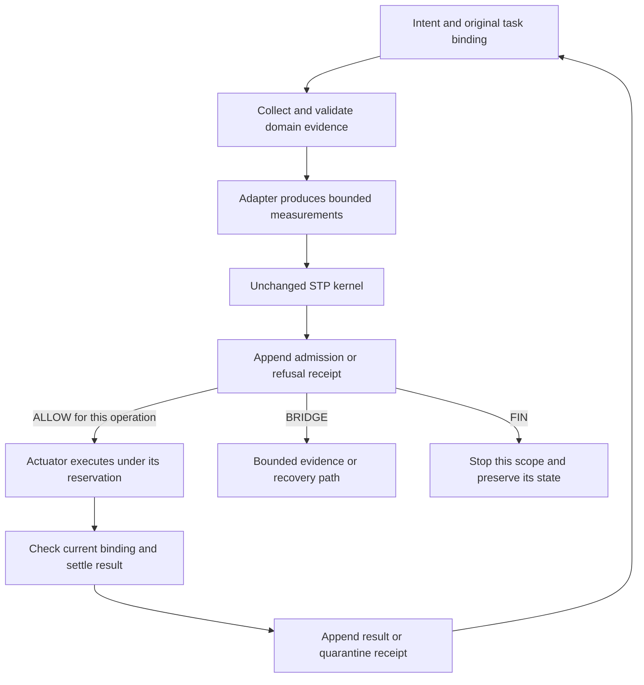

# A common operation boundary around the unchanged STP kernel

Status: scoped design proposal. This document describes the current implementation and a possible incremental extension. It does not enable new execution paths, change the canonical kernel, grant permissions, or migrate saved tasks.

The useful organizing principle is that every consequential operation has an accountable admission and settlement boundary. The kernel evaluates validated domain measurements at that boundary. It does not read files, interpret the user's intent, estimate memory, schedule workers, or decide whether an answer is true. Those responsibilities belong to adapters and host services, with their own evidence and failure records.

This makes the kernel a common decision point without inserting governance instructions into every model thought or holding a global lock throughout generation. Independent NPU retrieval and GPU generation can still run concurrently. Their reservations, observations and results must retain distinct identities and pass the applicable gates.

## The operation cycle

The adapter interprets a decision for its declared scope. `FIN` for one source-acquisition stage can mean handing partial findings and unresolved questions to the parent. It does not establish completion of the user's request. A runner Stop revokes that runner's permits while leaving the saved task available for an explicitly authorized continuation.

The observation collector and actuator are separate. A memory estimate is evidence for admission, not proof that the model has loaded; an accepted loading request is not proof of completed inference. Result admission needs its own current-state check.

## Current effect paths

The anchors below identify concrete entry points. “Covered” means the named path has the described checks and receipts; it does not mean every internal helper invocation has an independent kernel frame.

| Operation | Current entry points and coverage | Remaining boundary or tracing work |
| --- | --- | --- |
| Model inference | [InvocationGateway.invoke / _invoke and InvocationLedger.register / finalize](../harness/invocation_gateway.py) apply role, context, resource, task and orchestration checks. `INVOCATION_DISPATCH` commits the envelope before inference; `INVOCATION_RECEIPT` binds the result, admission and accounting afterward. | Normalize provider preparation, transport termination and result settlement into one effect timeline. Provider startup can precede the inference envelope; it must not disappear behind an inference-only receipt. |
| Source catalog, read, search and analysis | [repository_tools.execute / finish](../harness/repository_tools.py) enforce scope, source and operation budgets, hardware admission and immutable dispatch/result receipts. [review_source_receipts.acquire / reuse](../harness/review_source_receipts.py) bind reused evidence to its execution, request, permissions and verified current bytes. | Distinguish new acquisition from bounded verification of already paid evidence. Add a shared description of metadata/verification work rather than silently treating all reads as either free or new source exposure. |
| File edits | [host_actions.execute / replace_file / receipt](../harness/host_actions.py) check the admitted proposal, write permissions, resource/action budgets and source preimages. `HOST_ACTION_DISPATCH` precedes actuation; atomic replacement rechecks the preimage. | Preserve typed states for proposed, admitted, applied and uncertain. A transport timeout must not authorize replay of an edit whose outcome is unknown. |
| Tests | [host_actions.execute / run_tests_snapshot / run_provenance](../harness/host_actions.py) enforce allowed targets, bounded execution and sandbox snapshots, and retain artifact/runtime provenance in the action receipt. | Process exit observations remain distinct from verified assertions about correctness. Monitoring a long process needs its own bounded observation policy. |
| Runtime load and model replacement | [EngineModel.dispatch_gate](../harness/engine_model.py), [EngineWorker._load / _generate](../harness/engine_service.py), and [StrataModel.dispatch_gate](../harness/strata_model.py) check trusted profiles, runtime ownership, provider identity and resource readiness. | Give load/replace/unload effects explicit operation identities and before/after receipts in the task's audit lineage. Runtime status files and engine IPC are not, by themselves, task-ledger receipts. |
| Runtime recovery and unload | [runtime_memory.recover / lease / stable_resources](../harness/runtime_memory.py) distinguish shared versus exclusively owned servers. Owned Ollama release is bounded to one action and can record `MEMORY_RELEASE_PLANNED` and `MEMORY_RECOVERY_OBSERVED`; native recovery currently observes without releasing. | Standardize lifecycle tracing across providers. A measured resource recovery is not proof that an interrupted model call settled. Keep lease ownership and unknown outcomes separate from free-memory observations. |
| Governed tool installation and execution | [capabilities.preview / execute / finish](../harness/capabilities.py) bind proposals to task/source versions and approval or workspace policy; orchestration admission precedes `CAPABILITY_DISPATCH`. [capability_packages.install / run](../harness/capability_packages.py) perform the bounded package/check operation. | Carry a common effect identifier through download, verification, installation and execution stages. Preserve an interrupted installation as uncertain until verified; do not infer success from package presence alone. |
| Context retrieval and retention | [PagedContext.read_page / make_packet / prepare_delivery](../harness/paging.py), [conversation_memory.working_set](../harness/conversation_memory.py), and [memory_layer](../harness/memory_layer.py) retain receipt-backed pages, budget the selected working set and observe faults/deliveries. Context fit uses the Smriti adapter. | Make lookup, page restoration, index maintenance and device-backed retrieval costs explicit. Do not claim the optional NPU experiments are already a native chat retrieval path without identifying and validating that integration. A TOC locates retained evidence; it does not guarantee semantic recall. |
| Claim review and publication | [claim_pages.create / validate_plan](../harness/claim_pages.py) bind paged review plans; reviewer calls use the normal gateway. [report_review.request_check / published](../harness/report_review.py) require completed source-linked reviews and omit unsupported claim groups. | Publication filtering is host validation, not a separate general publication adapter today. A future publication admission should bind the exact candidate, review-page heads and source snapshot, while retaining `semantic_correctness_verified=false`. Model agreement is not proof. |
| Runner continuation and Stop | [task_continuation.describe / authorize / attach / stop](../harness/task_continuation.py), [orchestration_flow.handle](../harness/orchestration_flow.py) and [vscode_bridge.handle](../harness/vscode_bridge.py) gate automatic intents through `KarmaAdapter.task_continuation`. `RUNNER_CONTINUATION_DECISION` binds the UID, submission digest, checkpoint, task binding, kernel decision and latest chained permit. Stop adds an administrative `FIN` without closing or refunding the task. | Keep admission, transport cancellation, backend Stop acknowledgement and result settlement separately visible. A queued Stop is effective for scheduling immediately; its backend audit acknowledgement can still be pending. |

Some invalid paths, stale proposals and malformed requests fail preconditions before a domain dispatch record exists. The common boundary should make those typed refusals traceable too, with bounded rejected-intent records. It must not perform an unauthorized read or relax validation just to obtain a measurement for the kernel.

## Transport safeguards are not task judgments

[BridgeWorker.send](../bridge_worker.js), [Coordinator.runNext / waitForReadiness](../coordinator_service.js), and [lifecycle.deadline / reconcile](../harness/lifecycle.py) still contain host timers, process signals, queue limits and interruption handling. These are essential transport and resource safeguards. They are not evidence that reasoning failed, that a task finished, or that the same inference can safely be started again.

A common adapter should interpret measured progress and ownership at these boundaries before consequential recovery actions. A watchdog may stop an unresponsive transport, but the resulting effect remains unknown until reconciled. Work already reserved or consumed stays charged. A changed provider or a new window must not make that uncertainty disappear.

## Green, yellow and red

Green means normal admitted execution. The host does not repeatedly nudge the model to govern itself. Bounded progress counters can observe an active call without changing its task or output.

Yellow means obtain or reassess a specific missing measurement: fresh telemetry, a missing source page, a checkpoint, or the outcome of a pending operation. Monitoring cadence itself needs an admitted host-service allowance: maximum samples, bytes, concurrent probes and collection work per bounded interval. Poll timers schedule observations; elapsed time alone does not establish task failure. Unchanged observations should update a bounded diagnostic head or reuse a permit, not append an unlimited audit stream.

Red means a bounded refusal, quarantine, cancellation or explicitly admitted alternative for the affected scope. Escalation can mean better evidence, another context allocation, a different provider, a human decision or a partial handoff. It does not automatically mean a larger model. Every alternative still needs current permissions, physical capacity and remaining task allocation.

The existing [generation_progress.Progress](../harness/generation_progress.py) observer measures literal repetition only. Its counters do not establish semantic stagnation, active deliberation, contradiction or correctness. Any future intervention must preserve that distinction and be tested against productive slow reasoning as well as loops.

## Delayed results and context continuity

A delayed response belongs to the operation that created it, not whichever UI happens to be focused when it arrives. Its identity should retain the original task/session, contract epoch and hash, operation/invocation ID, source versions or snapshot head, provider instance and identity, admitted reservation and predecessor receipt.

At commit time, check that those dependencies still authorize this result. An epoch, source, policy or permission change can make an otherwise well-formed result historical evidence rather than a current executable proposal. Preserve the response and charge; quarantine or explicitly re-admit its use. Never silently transplant it into a new task.

Current gateway finalization already performs revision, policy, calibration, parent-checkpoint and page checks. Source/action paths have their own checks. The proposed work is to make the same boundary vocabulary and tracing available across effects, not to replace those checks with one scalar.

## Shared receipts and performance

Reuse the existing append-only `page_audit` chain and domain receipts. An operation record should identify its intent, scope, measurement/calibration provenance, original binding, admitted reservation, kernel frame, predecessor head and observation time. A result record should identify the exact admitted operation, changed artifacts, observed spending and admitted/quarantined/unknown outcome. Keep proposed decisions distinct from observed completion.

Admission must use bounded indexes and verified accounting checkpoints, not replay all prior history on every operation. Preserve detailed audit replay as an independent verification path that fails closed on mismatch. A hash chain inside one rewritable store is not protection against a privileged attacker who can replace the store and its trust anchors.

A local benchmark of 10,000 `KarmaAdapter.task_continuation(observation)` calls measured a 3.417 microsecond median and 4.25 microsecond p95. This includes adapter validation, frame construction and canonical kernel evaluation; it excludes evidence collection, hashing, SQLite, transport and device execution. It supports a narrow claim about this adapter/kernel path, not end-to-end governance overhead or portability to another machine.

Measure `collect`, `adapt`, `kernel`, `admission_commit`, `actuate`, `result_check` and `settlement` separately. Report p50/p95, open reservations and audit growth at increasing history sizes. These measurements can show whether a delay is in the kernel, the ledger, the provider or the host transport.

## Incremental scope and validation

1. **Inventory and observe.** Assign stable effect identities at existing boundaries and trace missing preparation/transport/publication stages. Do not alter admission behavior. Confirm that every visible pause and Stop can be followed to an operation, measurement and receipt.
2. **Unify lifecycle admission.** Add narrowly scoped adapter profiles for the confirmed gaps, using the existing gateway and canonical kernel. Keep legacy receipt validation unchanged; version new profiles explicitly. Start with runtime load/unload and publication, not a wholesale protocol migration.
3. **Govern observation work.** Admit monitoring allowances independently of model token budgets. Test green/yellow/red behavior, telemetry flapping, unavailable collectors, backoff, probe deduplication and exhausted monitoring allowance. A diagnostic failure must not strand settlement.
4. **Exercise delayed effects.** Pause and reload during model load, inference, source reads, test execution and installation. Switch models and task focus; revoke permissions; modify source; deliver a late response; stop before and after dispatch. Verify no lost context, duplicate effect, refund, stale permission or unearned completion.
5. **Measure under load.** Repeat concurrent NPU/GPU and growing-history trials with separate kernel, ledger, device and queue timings. Check that independent work remains concurrent while short admission/settlement transactions preserve accounting. Publish limits and failures as well as successful runs.

The acceptance condition is observable: every consequential effect has a current admission or a specific refusal; every dispatched effect settles or remains explicitly unknown; and recovery preserves its identity, context, permissions and spending.

## Supplied architectural reference

The supplied paper, *Governed Continuity Under Irreversible Distance: OO-LLM Node Architecture for a Starfaring Civilization's Mothership*, is a design reference. Its immutable-axis/local-frame distinction (p.2), proactive session chaining (pp.3,10), contextual handoff and predecessor audit hash (pp.7-10), local quarantine/fallback (pp.4,11-12), and preservation of independent signal warrants before composition (pp.12-13) are useful analogies for this operation boundary.

The paper's revival criteria, alpha/sigma formulas, financial-domain coupling constant and fixed-size TOC claims are not validated Sutra policies. The paper itself calls for domain-specific calibration (p.11). Nothing in this proposal imports those thresholds or treats the spacecraft scenario as empirical evidence about LLM behavior.
