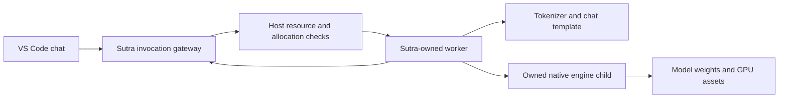

# Sutra-owned engine worker

Sutra 0.49.0 adds a direct execution path for a compatible native inference
engine. The worker launches the engine binary, sends token IDs through its
process protocol and receives generated tokens and completion metrics. It does
not invoke Strata Control, start a Strata HTTP server or send model calls to
Ollama. The compiled engine is still an inference dependency, alongside its
model data and GPU assets.

## What the release contains

The VSIX contains Sutra's worker, authenticated local client, profile handling,
model adapter and codec. The codec uses separately vendored MIT-licensed
tokenizer helpers with source hashes and license text. It imports no modules
from a Strata installation.

The following remain user-owned files outside the VSIX:

- A Python virtual environment with the pinned `regex`, `Jinja2` and
  `MarkupSafe` dependencies in `requirements-engine.txt`.
- The local model registry and its validated engine descriptors.
- A compatible native engine binary and its adjacent Metal/shader source assets.
- Tokenizer, chat-template and model/pack files, including any expert-profile
  data required by that engine configuration.

On this Mac these assets are staged under
`~/Library/Application Support/Sutra/Engine`. The engine and shader assets must
stay together. An engine executable copied without its required GPU sources is
not a complete runtime installation. Existing large model files may be reused
or cloned; the VSIX does not bundle or automatically download weights.

## Set up and select a model

1. Open **Sutra → Settings → Models → Sutra engine worker**, or run
   **Sutra: Manage Owned Engine Worker** from the Command Palette.
2. Choose **Set up worker** and confirm installation of the pinned codec
   dependencies. This creates or updates Sutra's own Python environment. The
   dependency setup log is stored beside it as `setup.log`.
3. Provision a model registry with a trusted descriptor for locally installed,
   compatible assets. Registration is currently a host provisioning step;
   **Set up worker** installs dependencies and does not discover or download
   arbitrary model weights. The registry API is described below.
4. Choose **Refresh worker**, select a registered model and choose
   **Load selected model**. Sutra checks resources, starts its own engine child
   and verifies a generation probe before reporting readiness.
5. Select `sutra:engine/<profile>` entries in the Low, Mid and High dropdowns,
   then choose **Save choices**. **Use selected for all tiers** changes only the
   draft selections until they are saved.

Loading or unloading a model does not change saved tier assignments, grant
workspace access, permit edits or reset a task allocation. Existing provider
choices remain available. Automatic stage routing can load the selected direct
profile on demand through the same invocation gateway.

The defaults are:

| Item | Default local path or setting |
| --- | --- |
| Engine Python | `~/Library/Application Support/Sutra/Engine/python/bin/python` |
| Model registry | `~/Library/Application Support/Sutra/Engine/models.json` |
| Python override | User setting `karma.engine.pythonPath` |
| Registry override | User setting `karma.engine.registryPath` |

These are application settings. Repository settings and model-generated text
cannot select another executable or authorize a model activation.

## Registry provisioning

`harness/engine_profiles.py` supplies `write(profiles, path)` and
`load("sutra:engine/<id>", path)`. `write` validates descriptors, binds the
installed artifacts and atomically writes a versioned registry. Operators
should use that API when registering a model rather than copying generated
fingerprint fields by hand.

Each profile describes the following information:

| Field | Meaning |
| --- | --- |
| `id` | Lowercase local identifier used in `sutra:engine/<id>` |
| `model` | Human-readable model identity |
| `engine.executable` | Absolute path to the installed native executable |
| `engine.args` | Reviewed model/pack arguments, with the matching context limit |
| `engine.cwd` | Absolute working directory for the owned child |
| `engine.environment` | Bounded engine-specific variables |
| `tokenizer_path` | Absolute directory containing the matching tokenizer assets |
| `context_tokens` | Context supported by this native configuration |
| `cold_memory_bytes` | Profile estimate in bytes, or `null` when unmeasured |

The registry also records descriptor and file-metadata bindings. A changed
tokenizer, binary, shader source or model artifact invalidates the old binding
and requires a reviewed reimport. Those bindings detect configuration changes;
they are not independent cryptographic attestation of multi-gigabyte weights.

The native argument list must come from a configuration supported by the
engine. A file with a `.gguf` extension alone does not establish compatibility.
The worker adds process-control flags such as `--serve` itself.

## Ownership, recovery and budgets

The worker is a persistent Sutra process with an authenticated private local
socket. It owns its engine child and records a separate worker/model instance
identity. Operations share the host runtime slot used by inference. Multiple
Sutra windows using the same runtime directory coordinate through that slot.

Loading a different profile releases the worker's previous child, checks fresh
hardware and memory admission, and loads the candidate. An already resident,
matching profile is reused with fresh hardware checks. An unknown cold
footprint remains labelled unmeasured; passing a hardware check is not a proof
of peak memory use.

Cancellation sends the native stop request and drains the current turn before
reuse. A process that cannot be reconciled is discarded by its owner; a later
request must verify a fresh child. The worker does not take ownership of an
unrelated provider process.

Task history, Smriti pages, pinned statements, constraints, permissions and
consumed budgets remain in the existing durable harness ledger. An engine
unload or restart does not create a new task or refund earlier work. A paused
request resumes through the existing recovery path, which checks the current
allocation and resources again. Native model output remains a proposal subject
to the role and evidence checks already enforced by the gateway.

The supplied canonical STP kernel is unchanged. Host adapters supply measured
resource and allocation inputs to it; the model is not asked to govern its own
permissions or spending.

## Current support and validation scope

The current direct path targets the installed Flash-Next native Metal
architecture on this Apple Silicon Mac. It does not establish support for the
installed dense 4B model or every architecture accepted by another runtime.
Additional architectures require compatible engine implementations/adapters.

The local 16K, 24K and 32K profiles share one set of model weights. They exercise
loading, context allocation and switching while retaining a task. They do not
represent three distinct model capabilities or independently trained reviewers.

The test modules cover process framing, readiness, owned-child shutdown,
cancel/drain recovery, profile bindings, local worker authentication, Unicode
decoding, literal control-token handling, and gateway continuity. The opt-in
`test/live-engine-worker.py` exercises the real worker. The optional reference
mode of `test/live-engine-codec.py` compares tokenizer output with the earlier
implementation solely during validation; normal codec execution has no such
dependency.

Live outcomes and measured timings should be read from the run's validation
artifacts. This document makes no general throughput or answer-quality claim.

## Local loading and continuity run — 2026-11-18

The direct worker ran against the locally staged model with foreign-runtime
entry points patched to fail. Four fresh caller processes used one durable task:
Low (16K), Mid (24K), a worker shutdown/restart into High (32K), and a fresh caller
reusing warm High. All four responses retained project Cedar-724, ticket CED724,
target 18, actual 21, the derived difference 3, the unchanged-kernel restriction,
and prohibitions on network, edits, tests and new dependencies.

| Phase | Native input tokens | Native output tokens | Cumulative settled tokens |
| --- | ---: | ---: | ---: |
| Low | 2,483 | 148 | 2,631 |
| Mid | 2,765 | 136 | 5,532 |
| Restart into High | 2,973 | 125 | 8,630 |
| Fresh caller, warm High | 3,126 | 125 | 11,881 |

The verifier checked unchanged task contracts and allocations, identical
permission flags, monotonic spending, preserved receipt prefixes and valid
receipt/audit chains. The service identity survived the Low-to-Mid switch;
model instance identity changed. A worker restart changed both identities.
The final High request reused the same ready instance. No workspace action was
performed. These are native tokenized-prompt and DONE counters; they do not
provide component-level attribution or prove semantic correctness in general.

A separate live component test cancelled generation after native progress,
verified stop/drain readiness, then reused the same instance. Thinking enabled
on the next arithmetic request produced 47 reasoning chunks and the correct
JSON answer for 17 × 19, with 115 input tokens and 57 output tokens in 6.54 seconds.
This is a small functional check, not a throughput benchmark. Native timeout
settlement and cancelled-load recovery additionally have deterministic tests.
