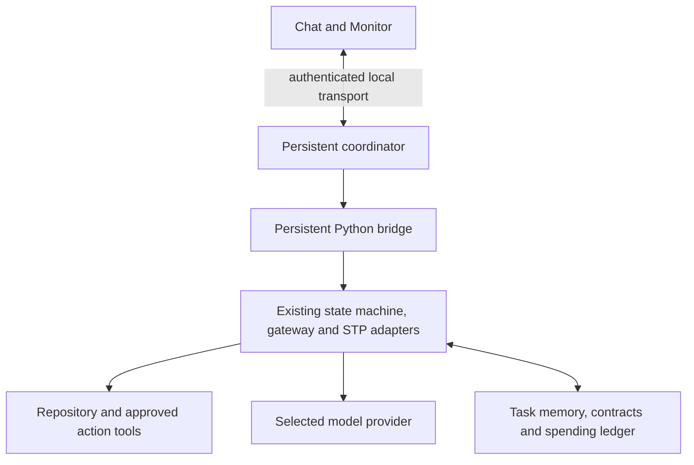

# Persistent request coordinator

Sutra 0.54.0 separates the chat connection from accepted execution. The existing
Python state machine and invocation gateway still own task authority, evidence
admission and spending. The canonical STP kernel is unchanged.

The coordinator runs independently of the VS Code extension host. It owns a
persistent bridge, one running request and a bounded queue. It does not generate
permissions, negotiate new task allocations or choose models. Each operation
continues through the existing Python checks when it actually executes.

## Disconnect and reconnect

Before a native orchestration request is submitted, the originating chat saves a
service-issued transport identity. The service commits acceptance before starting
the bridge. A lost acknowledgement is recovered by identity, never by submitting
the prompt again. Request content, environment, model choices and grant evidence
are bound to a digest and cannot change under an accepted identity.

Reloading VS Code, closing the display or cancelling its subscription detaches the
UI. Send **continue** in the original chat to reattach. A different chat cannot
consume the result. Restored activity uses the original call identities; bounded
replay may omit older reasoning chunks and is never action evidence.

Reattachment inspects the current core workflow before using the cached response.
A changed cursor/state is handled as a newer checkpoint; policy changes use the
existing recovery path. Workflow pointers are saved before the response is
acknowledged. Acknowledged results can later be evicted from the transport cache;
task context, evidence receipts and consumed spending remain in the domain ledger.

This preserves the accepted bridge **step**, not an unlimited autonomous task.
Further workflow steps and permission prompts continue after reconnection. The
coordinator never grants itself additional calls or runs ahead through approvals.

## Cancellation and revocation

Use **Stop runner request** in Monitor or the status-bar controls to request
execution cancellation. A running request remains `cancelling` until the Python
worker exits. That host acknowledgement does not establish that an interrupted
shared Ollama request has stopped. Existing runtime uncertainty remains retained.

Workspace revocation cancels queued work first, then requests cancellation of the
active worker, including operations without a native-chat transport ticket.
Queued native workspace operations also recheck the private permission record's
bytes immediately before dispatch. The proof is bound to the caller's validated
grant generation, scope and profile, so a replacement grant cannot silently
authorize a queued operation from the previous generation.

## Fault and retention boundaries

- The local endpoint binds to `127.0.0.1` with a random port and private random
  token. Protocol version, runtime identity, workspace and chat are checked.
- Private metadata, configuration and journal files require bounded regular-file
  reads, current-user ownership where supported, restrictive permissions and no
  symbolic or hard links. A service lock prevents competing journal writers.
- At most eight retained requests share a 16 MiB journal. Pending work reserves
  capacity for its result and bounded diagnostic replay, so admission can stop
  below eight jobs when that byte allowance is already reserved.
- Each response is limited to 4,000,000 bytes; each request's activity cache is
  limited to 512 KiB. Only acknowledged terminal entries are pruned. Monitor's
  **Dismiss** acknowledges a finished notification without deleting task history.
- A coordinator restart marks nonterminal entries interrupted. It never replays
  a tool, edit, test or model call. Durable workflow recovery reconciles receipts
  through the existing gateway, preserving charges for unknown outcomes.
- A failed journal write stops admission and withholds an unretained result.
  A content digest detects accidental or naive journal rewrites; it is not an
  authenticity guarantee against a privileged caller replacing the cache and hash.
- An idle coordinator can retire after fifteen minutes. Retained results remain
  on disk for a later client. Startup configuration files are removed after use.
- These transport records are a disposable delivery cache, not a second financial
  ledger, task memory store or grant authority. Workspace storage accounting also
  includes the coordinator directory.

Monitor distinguishes current observations from stale snapshots. It displays
queued, running, cancellation-requested and terminal states without interpreting
them as model correctness or hardware admission verdicts.

## NPU boundary

The earlier NPU experiment provides sentence embeddings and queued retrieval,
not a generative chat model. Its runtime and weights are not shipped or enabled
by this update. The coordinator establishes the independent worker boundary that
an explicitly configured retrieval lane can use later. Incoming-message reasoning
and evidence admission still use the selected models and existing gateway.
