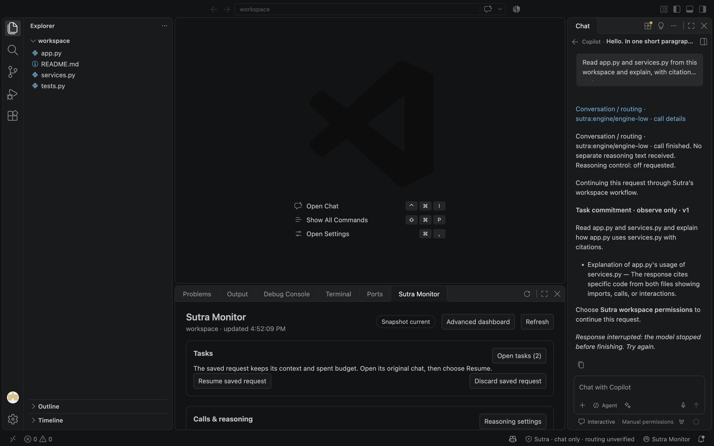
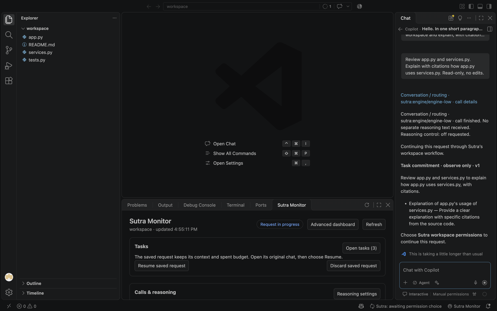

# Live native-engine session — Sutra 0.49.0

Date: 2026-11-18, 16:38–16:55 PT
Reviewer: QA and UX validation lead
Build: `HEAD fa245d7` + uncommitted 0.49.0 tree, packaged VSIX
Environment: macOS arm64, VS Code 1.147.0 (Electron 43), isolated profile and
extensions directory, four-file Python workspace, three `sutra:engine/*`
profiles registered, Strata server also running on `127.0.0.1:19483`.

Method: real VS Code window, real extension host, real native engine. UI actions
were driven through the Chrome DevTools Protocol (command palette, clicks, typing)
and captured as screenshots; one interruption was caused by the human user
clicking the permission popup, which is itself part of the finding.

Evidence: `docs/qa/screenshots/`.

## What worked

- VSIX installed into an isolated profile; extension activated.
- Status bar: `Sutra · chat only · routing unverified`; Sutra Monitor view present.
- Model picker registered **Sutra Auto** and the three engine profiles.
- A real native call completed through `sutra:engine/engine-low`:
  **5,230 input / 99 output tokens, 2 calls, 14 s**, footer `Memory restored`.
- Monitor showed live temperatures, memory, kernel decisions and token counts.
- Integrity manifest and packaged file set verified; the native engine worker
  started under the isolated profile (`engine_service.py`, pid recorded in
  `worker.json`).

## Timeline

| Time | Event | Result |
| --- | --- | --- |
| 16:38 | Install VSIX, launch isolated VS Code | activated, status bar shows Sutra |
| 16:39 | Command **Sutra: Open Chat (Sutra Auto)** | chat opened; model picker `Sutra Auto` |
| 16:42 | First prompt (conversation only) | **paused**: `RESOURCE_WAIT … thermal or memory pressure` |
| 16:43 | Click **Resume saved request** in Monitor | Copilot chat + **GitHub sign-in** prompts |
| 16:44 | Send `continue` in the original chat | **native answer**, 14 s, 5,230/99 tokens |
| 16:45 | Workspace prompt (read-only review) | `Continuing … Task commitment … Choose Sutra workspace permissions` |
| 16:47 | **User clicks the permission popup** | request interrupted |
| 16:48 | Chat result | `Response interrupted: the model stopped before finishing. Try again.` (3 m 28 s) |
| 16:52 | Retry the workspace prompt | `Choose Sutra workspace permissions` and **no dialog appeared** |
| 16:53 | Run **Sutra: Workspace Permissions…** | quick pick closed, **no dialog, no notification**, status unchanged |

## What confused the user (ranked)

### L-01 (S1) The permission choice is not an actionable control

At 16:52–16:53 the chat said **"Choose Sutra workspace permissions to continue
this request."** and the status bar said **"Sutra: awaiting permission choice"**,
but:

- the sentence is plain text — it is not a link or button;
- no `.monaco-dialog-box` and no `[role="dialog"]` existed in the DOM;
- no `Read only` / `Workspace agent` button existed anywhere in the window;
- running **Sutra: Workspace Permissions…** from the palette closed the palette
  and produced **no dialog and no notification**; the status stayed
  `awaiting permission choice`.

The only remaining controls are **Resume saved request** / **Discard saved
request** in the Monitor.

Code path: `arm()` refuses when a request is active and it is not the owner
(`native_provider.js:157`); the command registration has no catch
(`native_provider.js:1014`); the request-side call is
`native_provider.js:876`. If the owner state and the guard disagree, the arm
promise rejects with `Wait for the active Sutra request before changing
workspace permissions`, the rejection is not surfaced, and the workflow stays in
`NEED_PERMISSION` with no UI.

### L-02 (S1) Clicking/dismissing the popup kills the request with a misleading error

The user clicked the permission popup. The chat then displayed:

> **Response interrupted: the model stopped before finishing. Try again.**
> 4:48 PM · 3m 28s

That wording attributes the failure to the model. It was a permission decision.
**"Try again" is the wrong recovery**: it starts a new request instead of
resuming the saved one, and the notification separately says the saved request
and spent budget are retained and must be resumed from the Monitor.

The intended decline path exists — `native_provider.js:877` would report
"Workspace access was not granted. You can keep chatting." — but it was not what
the user saw, so the modal dismissal cancelled the stream before that branch.

### L-03 (S1) "Resume saved request" opens Copilot and asks for GitHub sign-in

Clicking **Resume saved request** (Monitor) at 16:43 produced:

- notification: `Signing in to github.com…` (twice);
- chat panel: "Sign in to use GitHub Copilot" with GitHub/Google/Apple/GHE buttons.

`recoverSaved()` resumes by executing `workbench.action.chat.open` with a
`modelSelector` (`native_provider.js:335-338`). On this VS Code build that opens
the Copilot-branded chat, not the originating Sutra chat, so the recovery path
is unusable without a GitHub account.

### L-04 (S2) Copilot branding on a local-only flow

The chat header reads "Copilot", the placeholder says "Chat with Copilot", and a
"Copilot" chip sits next to "Agent" — while the selected model is **Sutra Auto**.
For a local-only user this is contradictory and invites sign-in attempts. The
first conversation call did route through Sutra despite the branding, so this is
a presentation problem, but a costly one.

### L-05 (S2) `RESOURCE_WAIT` with a Monitor that says resources are fine

The very first call paused with "thermal or memory pressure requires resource
recovery". In the same window the Monitor showed:

- `System pressure: ALLOW`
- `OS thermal pressure: Normal · sample 0.8s old`
- `Available memory 26.1 GiB`
- `CPU temperature 41.4 °C`, `CPU usage 8%`

The actual blocking condition was the native runtime observation/first load, not
pressure. The advice ("Check System pressure and Last model allocation") points
at a healthy system, and the request resumes fine 14 s later.

### L-06 (S2) Host stage chatter in the transcript

The chat body contains lines such as:

- `Conversation / routing · sutra:engine/engine-low · call details`
- `call finished. No separate reasoning text received. Reasoning control: off requested.`
- `Task commitment · observe only · v1`

These read like model output or failures. They belong in a collapsed details
section or the footer, not in the conversation.

### L-07 (S3) Four names for one action

- Chat: "Choose Sutra workspace permissions"
- Status bar: "Sutra: awaiting permission choice"
- Command: "Sutra: Workspace Permissions…"
- Modal: "Workspace permissions for Sutra"

A user looking for the command will search "Arm" (the old name) or the chat
wording and find nothing.

### L-08 (S3) Duplicate tasks

The Monitor showed `Open tasks (2)` for what the user experienced as one request,
with a single Resume/Discard pair. It is unclear which task is current or which
one Resume will act on.

### L-09 (S3) "Restore Checkpoint" and other chat chrome

A new conversation shows "Restore Checkpoint", "Redo", "Keep"/"Undo" chrome
mixed with the Sutra answer. It adds noise around an already unfamiliar flow.

## Recommended fixes

1. **Inline control at the permission point.** Emit a real chat button/command
   link (`vscode.ChatResponseCommandButtonPart` / `stream.button`) alongside the
   text, with the same host command as the modal. Keep the modal for users who
   prefer it.
2. **Make dismissal safe.** A declined/cancelled permission must end with
   "Workspace access was not granted. The request is saved." plus a **Resume**
   button — never "Response interrupted / model stopped".
3. **Fix resume targeting.** Resume the exact originating chat. If the VS Code
   build cannot target it, fall back to the Sutra dashboard chat or show an
   explicit compatibility message; do not open the Copilot sign-in surface.
4. **Unify the label.** One phrase ("Workspace access") in chat, status, command,
   modal and Monitor.
5. **Explain resource pauses truthfully.** Distinguish first native load /
   runtime observation from pressure, and show the blocking measurement.
6. **Move host stage lines out of the transcript** into a details disclosure.
7. **Collapse duplicate tasks** or label them by time and prompt snippet.

## Reproduce

1. Fresh VS Code profile, install the VSIX, set `karma.models` to three
   `sutra:engine/*` profiles.
2. **Sutra: Open Chat (Sutra Auto)**, send a workspace prompt.
3. Observe `Choose Sutra workspace permissions` with no dialog; run
   **Sutra: Workspace Permissions…** and confirm nothing happens.
4. Click a permission popup if one appears; observe the generic interruption.

## Release impact

The governed workspace journey — the core of Sutra — is not usable end-to-end in
this session. L-01/L-02/L-03 are release blockers for 0.49.0 (S1 by the charter:
primary journey broken and the documented recovery path fails). The native
engine itself works and is fast once a conversation call is admitted.
